# Texere

**Research in one place**, inside [Obsidian](https://obsidian.md). · [Română](README.ro.md)

Texere is a free Obsidian plugin that brings the references, the reading and the writing of a research paper together in one place.

Research is usually split across several applications:
- Zotero or Mendeley for references
- a PDF reader for annotations
- Word for writing

Information gets lost on the way between them: a highlighted passage stays in the PDF, an idea noted two years ago can no longer be found, and a citation has to be checked once more in the text. Texere links these steps together, and Zotero can remain your database.

## 0. Installing

The Texere plugin installs with the same steps on Windows and on Mac:
1. Install [Obsidian](https://obsidian.md/download) and create a new vault. If you already have a vault in Obsidian, go on from step 2.
2. In **Settings → Community plugins** click **Turn on community plugins**, then install and enable the **BRAT** plugin.
3. From the command palette (**Ctrl/Cmd + P**) choose **BRAT: Add a beta plugin**, paste `gorgmihai92/texere-plugin` and click **Add plugin**.
4. Texere prepares everything by itself. In an existing vault it only adds what it needs to work properly, without moving anything you have.

## 1. The home page

Texere's home page opens from the braided icon at the top left or from any new tab (+). Its bottom bar takes you to the four parts of the plugin:

- **Home**: your first steps, your recent notes and what's new in Texere.
- **References**: you search for and add works from online catalogs or from Zotero.
- **Export**: you get your essay, article or thesis as PDF, Word or Markdown, with the citations and bibliography in the style you chose.
- **Insights**: statistics about what you write and read, together with the links between ideas.

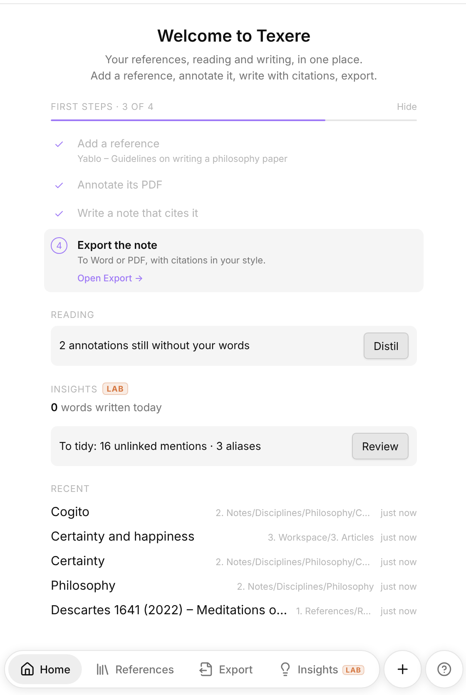

## 2. References

You add a reference by searching for the author, the title of the article or book, the ISBN or DOI, by pasting a BibTeX entry, or from your Zotero library. Each reference becomes a reading note, and Texere downloads the PDF when it finds one. If it doesn't, you add it yourself.

For Texere to talk to Zotero, turn on **Allow other applications on this computer to communicate with Zotero** in Zotero's advanced settings (**Zotero → Preferences/Settings → Advanced**).

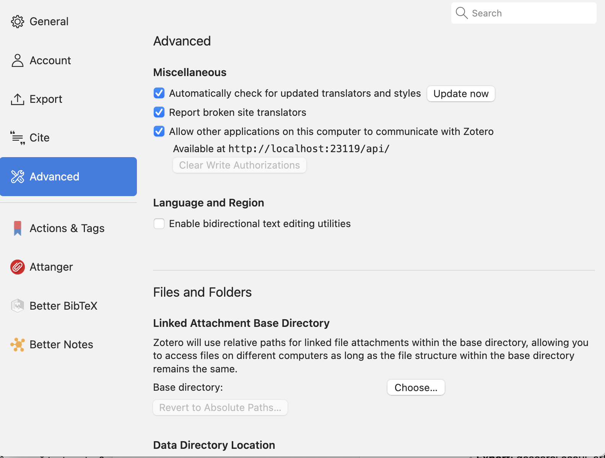

How it works:
- **Search**: type the title, author, DOI or ISBN, and Texere searches open academic catalogs such as OpenAlex, Crossref, Semantic Scholar and Google Books. For each result you see the year, the journal, the number of citations and whether the PDF is free. **Add to vault** brings the metadata (author, title, year, journal, DOI) together with the PDF, when there is one.

  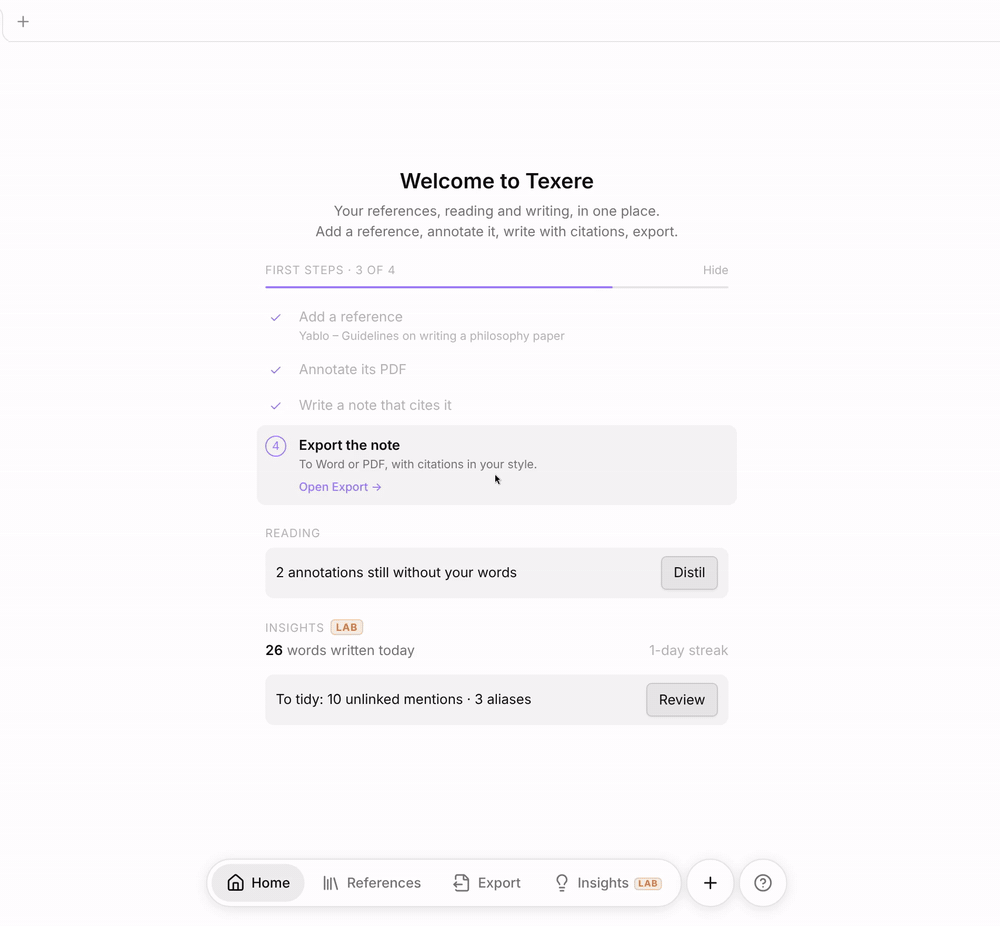

- **Zotero**: you see your Zotero library and tick what you want to add. **Import references** brings only the metadata, while **Import references and PDFs** also brings the PDFs, with the highlights and annotations you made in Zotero.

  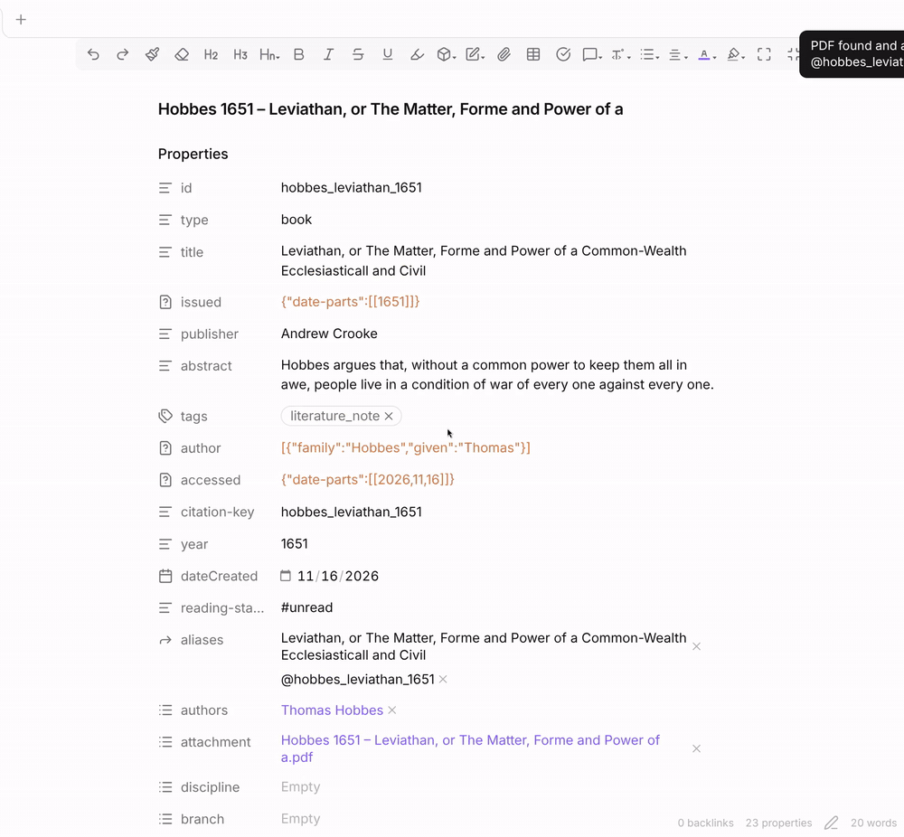

- **Other ways**: you can paste a citation, a BibTeX entry or a DOI, fill in the metadata by hand, or save a reference from your browser with Zotero Connector.

**Why it helps**: the reference, the PDF and your notes stay together, in Markdown files, on your computer.

## 3. Reading and annotating

You read and annotate PDFs right in Obsidian. Each colour has a tag, and the passage you highlight goes into the reading note by itself, with the page, the citation and a link back to the exact place in the PDF.

How it works:
1. Open the PDF next to the reading note.
2. Choose a colour and select a passage.
3. The passage is added to the note by itself.

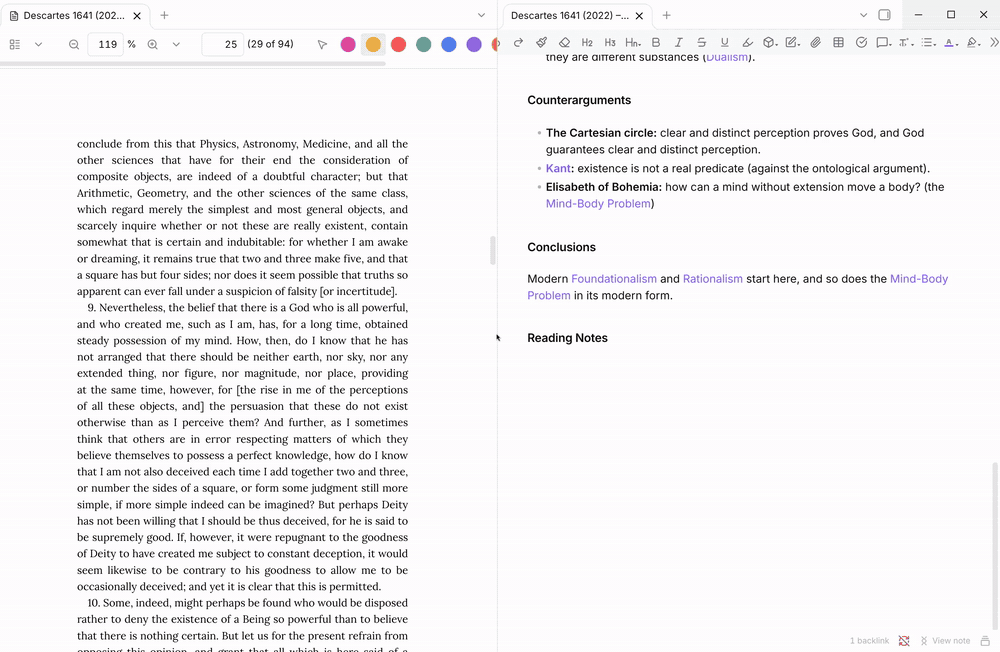

| Colour | Tag | What you mark |
| --- | --- | --- |
| pink | `#fact` | facts, dates, figures |
| yellow | `#claim` | the author's claims |
| red | `#disagree` | what you disagree with |
| teal | `#agree` | what you agree with |
| blue | `#connection` | links to other texts |
| purple | `#question` | questions |
| orange | `#definition` | definitions |
| grey | `#word` | terms to remember |

**Why it helps**: in an ordinary PDF reader, highlights stay in the file. Here they become notes you can search across all your readings, for example everything you marked `#disagree`. The colour you choose while reading is already a first judgement about the text. Under each passage you can write one or two sentences in your own words (**Distil**), so that when you start writing, your material is already sorted and cited.

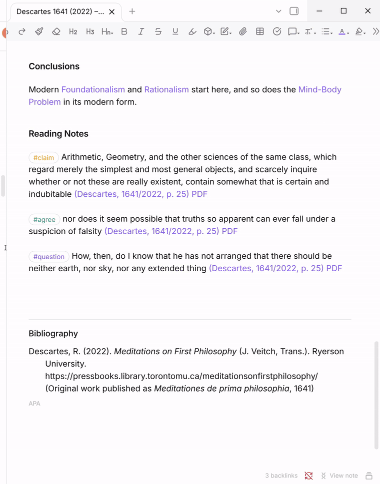

Each colour also has a shortcut, from **Alt+1** to **Alt+8** (**Option** on a Mac), in the order of the table. With text selected, it highlights it in that colour. Without a selection, it picks the colour for the next highlight. If you'd rather underline than highlight, click the highlighter button right after the colours, or press **Alt+U**. The colours then draw a line under the text, with the same tags, and the same button takes you back to highlighting.

If you only want to read, the **pointer** in the PDF's toolbar (or the **H** key) lets you select text to follow the line, without it being copied into the note.

## 4. The map of philosophy

Texere comes with a map of philosophy, with a note for each branch, theory, concept, movement, period and author, starting from the *Philosophy* note. The notes have English names and Romanian aliases, so typing `[[Etică` gives you *Ethics*.

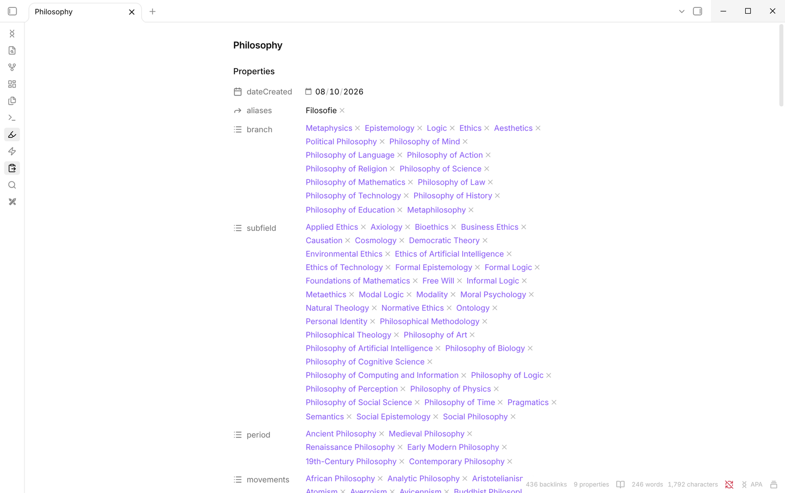

How it works: each reference and each note gets a few properties (*discipline*, *branch*, concepts, authors) that point to notes in the map. A reading marked *branch: Epistemology* shows up on the Epistemology page, next to the other readings in the same branch.

In the Obsidian graph, which you open with **Ctrl/Cmd + G**, each dot is a note and the lines are the links between them. Branches, subfields, concepts, theories, movements, periods and authors each have their own colour. The colours come with Texere, and in an older vault the home page offers them with the **Add** button.

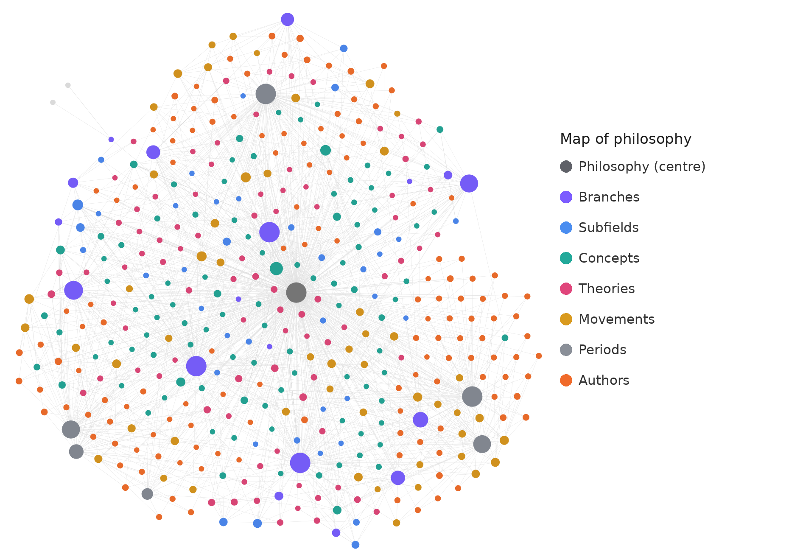

**Why it helps**: your readings are no longer ordered only by folders or courses, but also by branches and concepts. When you open a concept, you see everything you have read and written about it. The map can be adapted to other disciplines too.

## 5. Citations and bibliography

You add citations right in the text, from your references or from Zotero, and the bibliography builds itself at the end of the note.

How it works:
1. Type `@` in a note, followed by a word from the author's name or the title.
2. Your references appear and, if Zotero is open, those from Zotero too, marked with the **Zotero** label.

   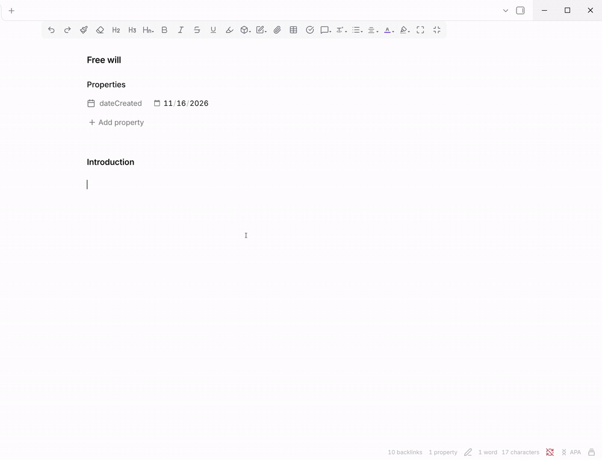

3. Choose the reference. For one from Zotero you can choose between **Reference only**, which brings only the metadata, and **Reference and PDF**, which also brings the annotations from Zotero.

   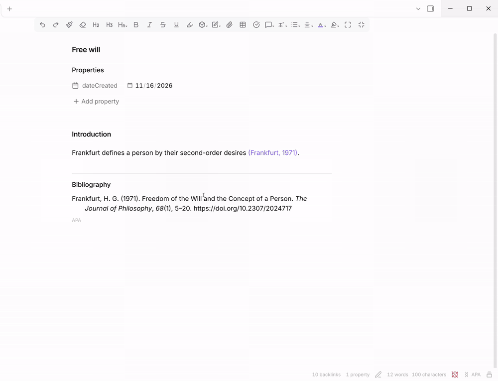

4. Add the page, for example `[@descartes_meditations_2022, p. 29]`.

In the note, the citation shows formatted, for example *(Descartes, 1641/2022, p. 29)*. The bibliography updates as you write, so each reference you cite appears in it at once, and one you no longer cite disappears.

To change a citation, click it and choose **Edit the citation**: you can swap the reference or add the page, and the bibliography follows.

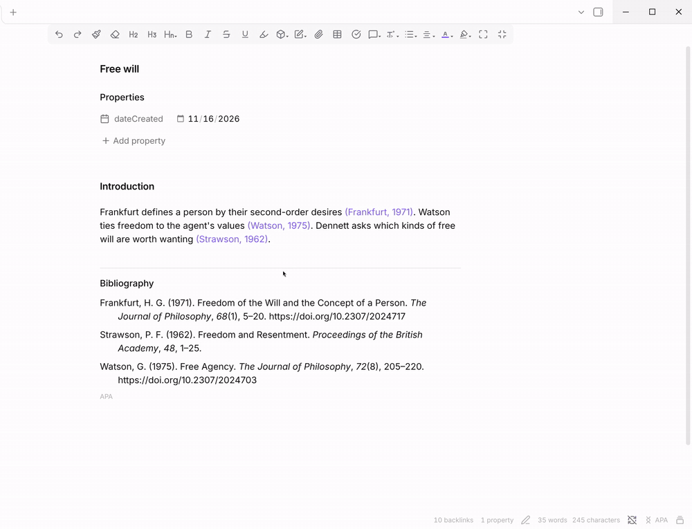

You change the citation style from the bottom bar. Click **APA** and choose another style (Chicago, MLA, Harvard, IEEE) or **Add a citation style…**, from more than 10,000 available. The citations in the text and the bibliography are redone on the spot, and the export uses the same style.

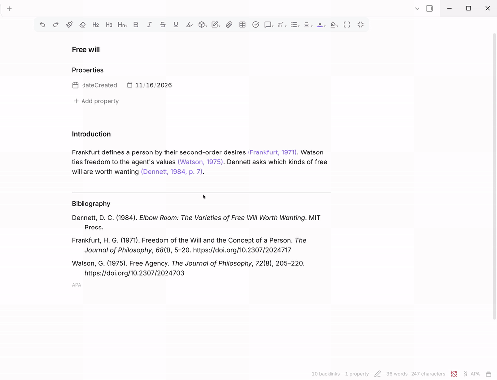

**Why it helps**: it works much like the Zotero plugin for Word, but in the same place as your notes and PDFs. A click on a citation takes you to the reference or to the page in the PDF.

## 6. Edit mode

When you have a draft, Edit mode helps you rework it without losing anything. You try versions of a word, a sentence or a paragraph right in the note, and nothing is final until you choose.

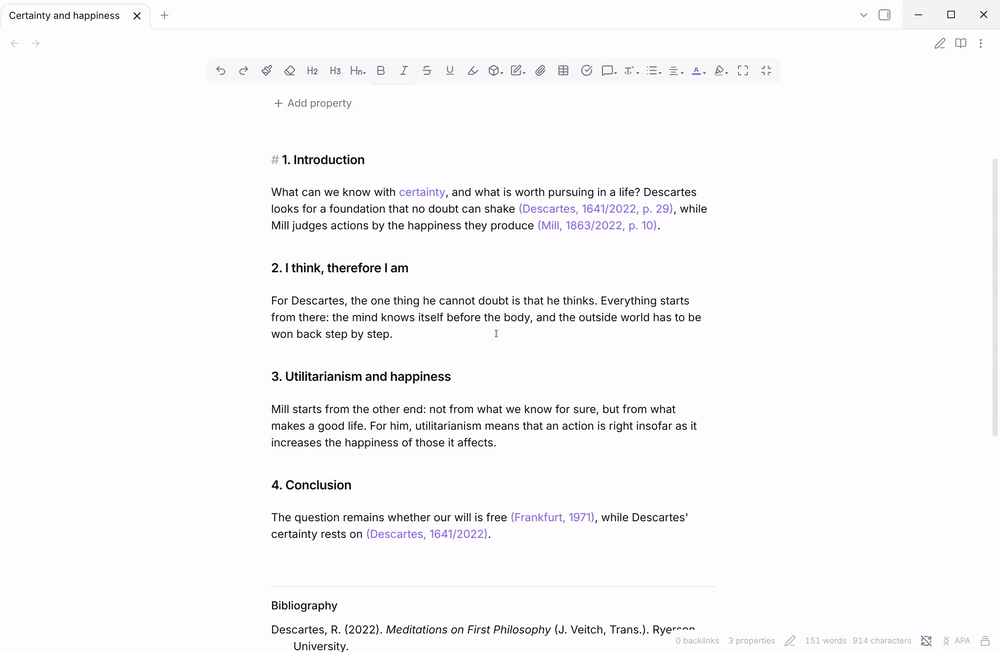

How it works:
1. Turn it on with ✎ at the top of the note, or with a right-click on the note, **Texere** and **Edit mode**.
2. Select a word, a sentence or a paragraph and choose **Versions**. Write a version, press **Enter** and click any version to see it in the page. **Keep what's showing** keeps the one you chose, and the original stays in the list until then.
3. **Dim** fades a passage, so you can read the page without it, and a click brings it back. **Move to Cuts** takes it out of the text and keeps it in **Cuts**, from where you can bring it back at any time.
4. The **Texere** button marks long sentences, hedges or claims stated too strongly, following the writing guides, without AI.
5. Click **Done** when you have finished.

**Why it helps**: rewriting usually means deleting, and a good sentence gets lost on the way. Here the original stays next to each version, the rest of the page fades so you see only what you rewrite, and what you cut is kept for this note.

## 7. Export

Any note can be exported to PDF, Word or Markdown, with the citations and bibliography in the style you chose.

How it works: click **Export** in the bottom bar, choose **PDF**, **Word** or **Markdown**, check the preview and click **Export**.

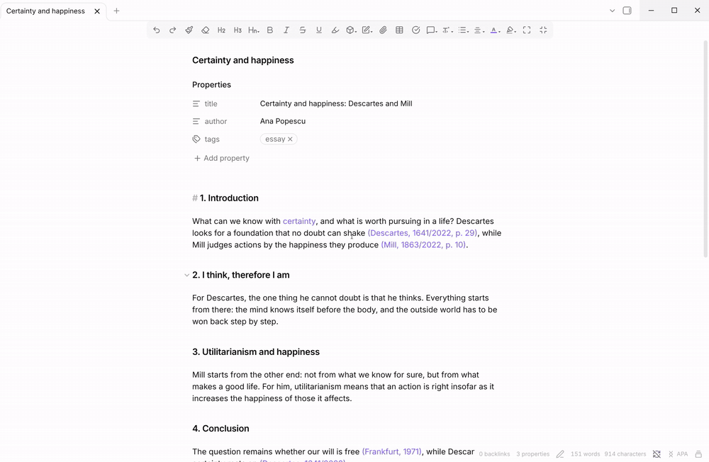

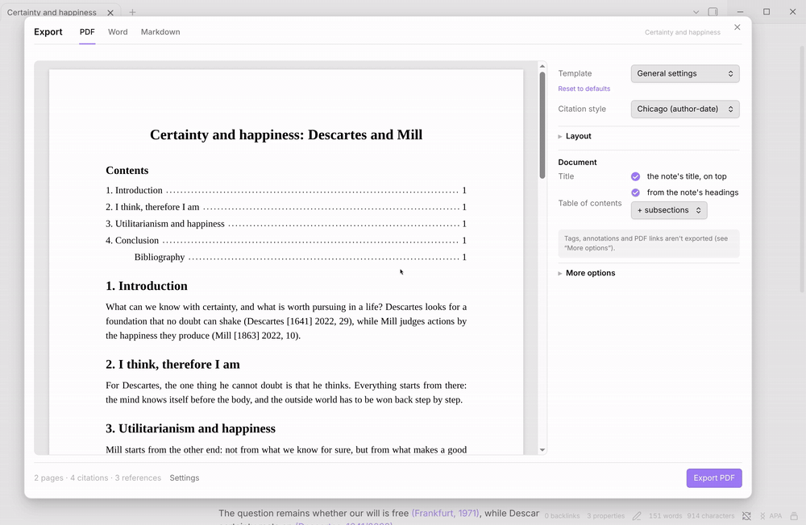
The page layout comes from the template, which can be a general one or the Faculty of Philosophy's, following the writing guide for BA and MA theses. The table of contents and page numbers are added by themselves, and the Word file can be sent on for corrections like any other document.

In the same window you can change the citation style or add a table of contents, and the preview follows.

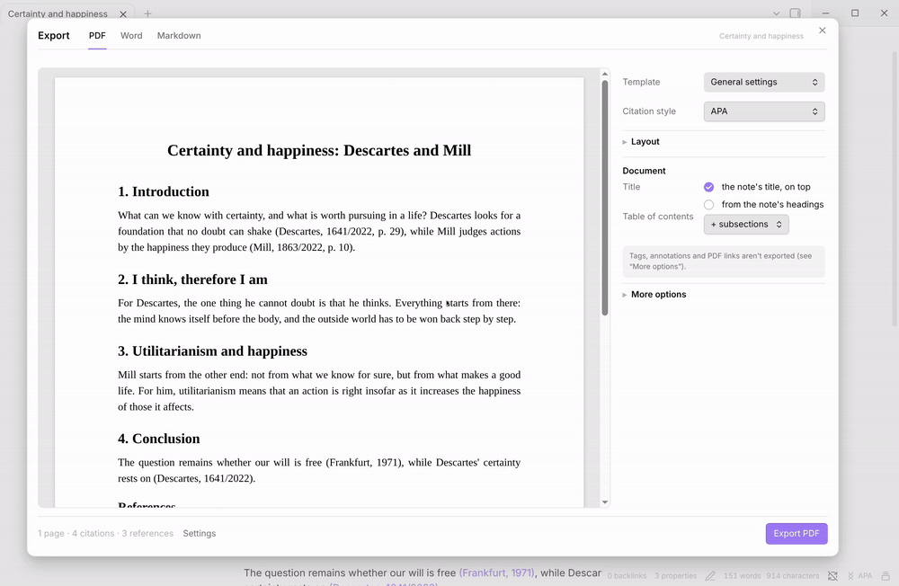

## 8. Insights (BETA)

Insights reads the notes in your vault and shows you how your ideas link together. The analysis runs locally, on your computer, with programming rules and no artificial intelligence models.

For research, the most useful part is the **Debate map**. You choose a concept, for example *Happiness*, and see on a single page every passage you highlighted about it, across all your readings. Each passage has its citation, page and your note, and the passages are grouped by the author or chapter they come from.

How it works:
1. Open the map from the concept panel or from Insights, in the **Reading** tab, with the **Debate map** button.
2. Choose what interests you with the filters at the top, for example **You disagree** and **Claims and definitions**.
3. Click **Start a note from these…**, and Texere creates the draft of a new text with the passages you chose, grouped by kind, with the citations already in place and a line for your answer under each one.

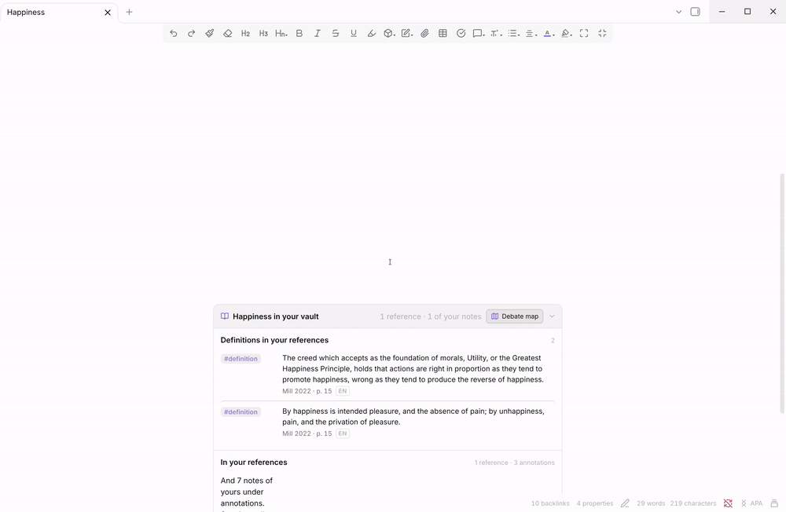
Besides the debate map, Insights helps you in three more ways:
- **Missing links**: it finds the concepts and authors you mentioned without a link, the names that don't have a note yet and possible duplicates. **Review** groups them, and **Link selected** adds the links without changing your text, so that *“actions”* becomes a link to the concept *Action*. For a name without a note, **Where it's used** shows the sentences where it appears, and a name close to an author you have (*Granding* and *Temple Grandin*) is marked as a possible misspelling.
- **Concept panel**: in a concept's note you see its definitions from your references, the notes where you use it and the concepts it appears with in the same paragraphs.
- **Patterns**: you see what you read but don't use in your writing, the topics that keep coming back and the concepts that appear together without being linked.

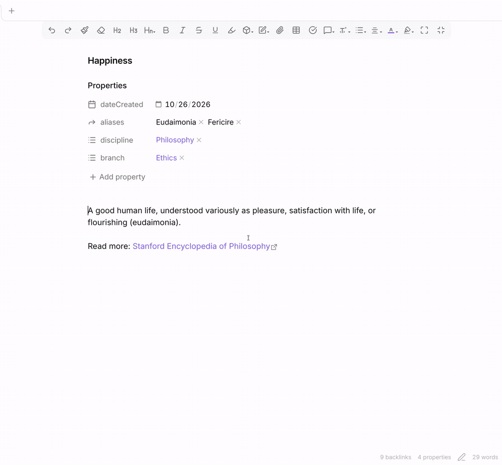
**Why it helps**: in a folder of Word documents, the link between a text read two years ago and today's idea depends on memory. In Texere, the passages you highlighted about the same concept gather by themselves from all your readings, and a new article can start straight from them.

## More details

- **The setup**: choose your language and click **Next** until the end. Texere prepares the folders, the bibliography and citation styles, the map of philosophy, the templates, the writing guides and PDF++, the plugin for annotations. You can run it again at any time from **Settings → Texere → General**.
- **Catalogs**: if a catalog says you've reached its daily limit, add a free key in **Settings → Texere → References → Catalogs**. A PDF you already have becomes a reference with **Ctrl/Cmd + P** and **Texere: Add this PDF as a reference**.
- **Zotero**: a reference already in your vault only gets what it is missing, so nothing is doubled, and Better BibTeX is not needed. With a Zotero key, added in **Settings → Texere → References → Zotero**, importing works with Zotero closed too. That is also where you turn on the Zotero browser button.
- **Where highlights go**: the first time you highlight in a PDF, Texere asks which note the passages go into: the reading note or another note the PDF is attached to, such as a seminar note or an essay. You can also choose **Nowhere**, and then the highlights stay only in the PDF. Texere saves each passage in that note in the background, without opening it, and if the note is open, you see the passage appear. You change the choice from the PDF's bottom bar, where **Annotations →** shows the current note, or with a right-click on the PDF, **Texere** and **Where new annotations go…**. The highlights you left in the PDF you add later to any of its notes, from the same bar with **Import annotations into a note…**, or from the note itself, with a right-click, **Texere** and **Import annotations from PDF**.
- **Annotations**: you delete a highlight either from the note or from the PDF, and it disappears from both. Annotations made in another app, such as Zotero, Preview or Acrobat, come into the note too, and the ones made later you bring in with a right-click on the note, **Texere** and **Import annotations from PDF**.
- **Shortcuts**: all of them are in Help, in **1.4 Shortcuts**, for example **Ctrl/Cmd + U** to underline in a note.
- **Graph colours**: if they are missing, add them with **Ctrl/Cmd + P** and **Texere: Colours in the graph for the discipline map**.
- **Citations**, in short:

  | You type | You get (APA) |
  | --- | --- |
  | `[@descartes_meditations_2022, p. 29]` | (Descartes, 1641/2022, p. 29) |
  | `[@descartes_meditations_2022; @mill_utilitarianism_2022]` | (Descartes, 1641/2022; Mill, 1863/2022) |
  | `@descartes_meditations_2022 [p. 29]` | Descartes (1641/2022, p. 29) |

- **Export**: you make a template of your own in **Settings → Texere → Export**, and you choose the folder the files go to in **Settings → Texere → General → Folders**. You put the table of contents where you want it with a right-click in the note, **Texere** and **Insert the contents here**.
- **Writing**: the **Writing** tab in Insights shows how much and how you write, and **Check this draft**, in the **Writing companion** (right-click on a note and **Texere**), shows what each paragraph does and what is still missing, following Texere's writing guides.

## Updates and help

Texere looks for new versions by itself and shows them on its home page, where you install them with **Update**. Inside Obsidian, the **?** button on the home page opens the guide and the frequent questions. A problem or an idea: **Settings → Texere → About → Report a problem**, or write to [hi@georgemihai.com](mailto:hi@georgemihai.com). All versions: [CHANGELOG](CHANGELOG.md).

## Privacy

Texere connects to the internet only when you use a feature that needs it (searching for a reference, downloading a PDF or a citation style, checking for updates), and never sends the content of your notes. No ads, no tracking, nothing sent to the author. The full list is below.

<details>
<summary>Everything Texere connects to and accesses (for [Obsidian](https://obsidian.md)'s plugin review)</summary>

Obsidian asks plugins to state what they connect to and what they access. Here is everything Texere does.

### Network use

Texere sends requests only when you use a feature that needs them (searching, adding a reference, opening Reference stats…). It sends the words you search for, a DOI, an ISBN, a title or an author name, never the content of your notes, except where stated below.

| Service | Why Texere uses it |
|---|---|
| [OpenAlex](https://openalex.org) (`api.openalex.org`) | Search for works; citation counts, field-normalized impact, top-cited status and retractions in Reference stats; journal ratings; references for the debate map. Works without a key; an optional free key raises the daily limit. |
| [Crossref](https://www.crossref.org) (`api.crossref.org`) | Search for works; metadata from a DOI; a book's DOI from its ISBN. If you enter your e-mail in settings, it is sent as Crossref's recommended `mailto` parameter. |
| [doi.org](https://www.doi.org) | Metadata for a DOI. |
| [Semantic Scholar](https://www.semanticscholar.org) (`api.semanticscholar.org`) | Search for works; "influential citations" in Reference stats. Only with your own key. |
| [scite](https://scite.ai) (`api.scite.ai`) | How many citations support, contrast or mention a work. |
| [Open Library](https://openlibrary.org) | Search for books and look them up by ISBN. |
| [Google Books](https://books.google.com) (`www.googleapis.com/books`) | Search for books. |
| [Wikipedia's citation service](https://www.mediawiki.org/wiki/Citoid) (`en.wikipedia.org`) | Metadata from a URL, ISBN, arXiv or PubMed identifier. |
| [ORCID](https://orcid.org) (`pub.orcid.org`) | The works of an author from their ORCID. |
| [SerpApi](https://serpapi.com) (`serpapi.com`) | Google Scholar search, only with your own SerpApi key. |
| [Europe PMC](https://europepmc.org) (`www.ebi.ac.uk`) | A free PDF for biomedical articles. |
| [Unpaywall](https://unpaywall.org) (`api.unpaywall.org`) | A free, legal PDF for a DOI; only if you enter your e-mail in settings (Unpaywall requires it). |
| Open-access PDF links (arXiv, Europe PMC, PubMed Central, Frontiers, PLOS, Springer, SAGE, Taylor & Francis, Wiley, eLife, the Royal Society) | Download a reference's free PDF when you ask. |
| [Zotero Web API](https://www.zotero.org/support/dev/web_api/v3/start) (`api.zotero.org`) | Import your Zotero library without Zotero open; only with your own Zotero key. |
| Zotero desktop on your computer (`127.0.0.1:23119`) | Import from Zotero while it is open. Never leaves your computer. |
| GitHub (`raw.githubusercontent.com/citation-style-language/styles`) | Download a citation style you choose. |
| GitHub (`api.github.com`, `github.com/gorgmihai92/texere-plugin/releases`) | Check once a day for a new version; download it only when you press **Update** (see [Updates](#updates)). Nothing about you is sent. You can turn the check off. |
| [Wikidata](https://www.wikidata.org), Wikipedia and [MyMemory](https://mymemory.translated.net) | Suggest Romanian titles for your concept notes, only when you press the button; the titles (up to 80 at a time) are sent. |

Links to library catalogs (the National Library of Romania, WorldCat and others) open in your browser; Texere doesn't contact them.

### Files outside your vault

Texere is desktop only because some features read or write files outside the vault, always for a feature you use:

- **Downloads:** after you open a reference's PDF in the browser, Texere watches Downloads for up to 10 minutes and attaches the PDF you save there. Nothing else is read.
- **Your Zotero data and profile folders:** to copy the PDFs of the items you import, read the site translators the browser button needs when Zotero is closed, and notice when Zotero starts.
- **Linked files in Zotero:** copied into the vault when you import their item.
- **A temporary folder** (`texere-zotero`) for PDFs the browser button sends while Zotero is closed.
- **The export folder**, if you choose one outside the vault, and opening exported files with your system's app.
- **Documents you choose to import.**

Programs and local services, only on request: answering the Zotero Connector on `127.0.0.1:23119` while Zotero is closed (off by default; it checks the list of running apps with `ps` or `tasklist`); converting .doc, .odt or .rtf with macOS's `textutil` or LibreOffice; reading the clipboard for clean paste.

### What Texere writes in your vault

Markdown notes and the files of the features you use: reading notes and their PDFs; annotations in reading notes; the bibliography in `Support/Texere/Bibliography`; Cuts in `Support/Texere/Cuts`; exported files; the notes you write in Distil, the debate map or the writing companion; templates and guides when you add them; a weekly review if you turn it on; the suggested folders and the discipline map when you ask. Texere never deletes your notes; where it replaces something you asked it to, it keeps a copy first.

### Other plugins

- **PDF++:** Texere reads its settings (your color palette and copy templates) so the annotations it brings in look like the ones PDF++ pastes. Templates are read, never run. The setup can fix one part of an old copy template, only when you click.
- **The old Texere plugins** (Texere · Sources, Texere · Export, Texere · Insights): if they're still on, Texere asks before turning them off and copies their settings (see [MIGRATION.md](MIGRATION.md)). Nothing is deleted.

### Accounts, ads, data

Everything works without an account, except Google Scholar search (your own SerpApi key). Other keys are optional: OpenAlex, Semantic Scholar, Zotero Web API, and your e-mail for Unpaywall and Crossref. No ads, no paid features, no usage data: nothing about you or your notes is sent to the author. Your files are ordinary Markdown and PDF in your vault; Texere's settings are in `.obsidian/plugins/texere/data.json`; writing counts and the Insights index stay per device in the plugin's folder.

</details>

<details>
<summary>For developers: building from source</summary>

```
npm ci
npm run dev     # readable main.js, for testing
npm run build   # minified main.js, for a release
```

When the version in `manifest.json` changes on `main`, the GitHub Action in `.github/workflows/release.yml` builds the plugin and prepares a draft release (files and notes from `.github/release-notes/<version>.md`); publishing it on the Releases page makes it reach everyone.

</details>

## Credits

Texere bundles these libraries and data in its `main.js`; each keeps its own license:

- [citeproc-js](https://github.com/Juris-M/citeproc-js) by Frank Bennett: citations and bibliographies. CPAL 1.0 or AGPL 3.0.
- [docx](https://github.com/dolanmiu/docx) by Dolan Miu: Word export. MIT. Includes [JSZip](https://stuk.github.io/jszip/) (MIT or GPLv3, used under MIT) and [pako](https://github.com/nodeca/pako) (MIT and Zlib).
- [markdown-it](https://github.com/markdown-it/markdown-it) and [markdown-it-footnote](https://github.com/markdown-it/markdown-it-footnote): PDF export and preview. MIT.
- [Paged.js](https://pagedjs.org): page layout for PDF export. MIT. Includes [CSSTree](https://github.com/csstree/csstree) (MIT) and [mdn-data](https://github.com/mdn/data) (CC0).
- [Citation Style Language](https://citationstyles.org) locales and styles: CC BY-SA 3.0.
- Annotations in PDFs: [PDF++](https://github.com/RyotaUshio/obsidian-pdf-plus) by Ryota Ushio, a separate plugin you install yourself.
- Edit mode: based on [Wordplay](https://github.com/ungatedlife/wordplay) by Rob Hardy (MIT), after Jason Fried's Write_On.
- Journal ratings: from OpenAlex, which collects the Norwegian Register, the Finnish Publication Forum (JUFO), ERIH PLUS and DOAJ.
- The guide (`assets/help`), the templates and guides (`assets/notes`) and the Philosophy map: by George Mihai, CC BY 4.0.

## License and author

Texere is made by [George Mihai](https://www.georgemihai.com/?utm_source=texere&utm_medium=github_plugin&utm_campaign=texere) ([hi@georgemihai.com](mailto:hi@georgemihai.com)). The code is under MIT, and the guides and the Philosophy map are under CC BY 4.0 (see [LICENSE](LICENSE)).
