# Texere

**Cercetarea într-un singur loc**, în [Obsidian](https://obsidian.md). · [English](README.md)

Texere este un plugin gratuit pentru Obsidian care adună într-un singur loc referințele, lectura și scrisul unei lucrări științifice.

De obicei, cercetarea se împarte între mai multe aplicații:
- Zotero sau Mendeley pentru referințe
- un cititor de PDF pentru adnotări
- Word pentru scris

Pe drumul dintre ele se pierd informații: un pasaj subliniat rămâne în PDF, o idee notată acum doi ani nu mai e găsită, iar o citare trebuie verificată încă o dată în text. Texere leagă acești pași între ei, iar Zotero poate rămâne în continuare baza ta de date.

## 0. Instalarea

Pluginul Texere se instalează urmând aceiași pași pe Windows și pe Mac:
1. Instalezi [Obsidian](https://obsidian.md/download) și creezi un seif nou. Continuă de la punctul 2 dacă ai deja un seif în Obsidian.
2. În **Settings → Community plugins** apeși **Turn on community plugins**, apoi instalezi și pornești pluginul **BRAT**.
3. Din lista de comenzi (**Ctrl/Cmd + P**) alegi **BRAT: Add a beta plugin**, lipești `gorgmihai92/texere-plugin` și apeși **Add plugin**.
4. Texere pregătește totul automat. Într-un seif existent adaugă doar ce are nevoie pentru a funcționa corect, fără să mute nimic din ce ai.

## 1. Pagina de pornire

Pagina de pornire Texere se deschide din iconița împletită din stânga sus sau din orice tab nou (+). Din bara ei de jos ajungi la cele patru părți ale pluginului:

- **Acasă**: primii pași, notele recente și noutățile din Texere.
- **Referințe**: cauți și adaugi lucrări din cataloage online sau din Zotero.
- **Export**: descarci eseul, articolul sau teza în PDF, Word sau Markdown, cu citările și bibliografia în stilul ales.
- **Insights**: statistici despre ce scrii și ce citești, împreună cu legăturile dintre idei.

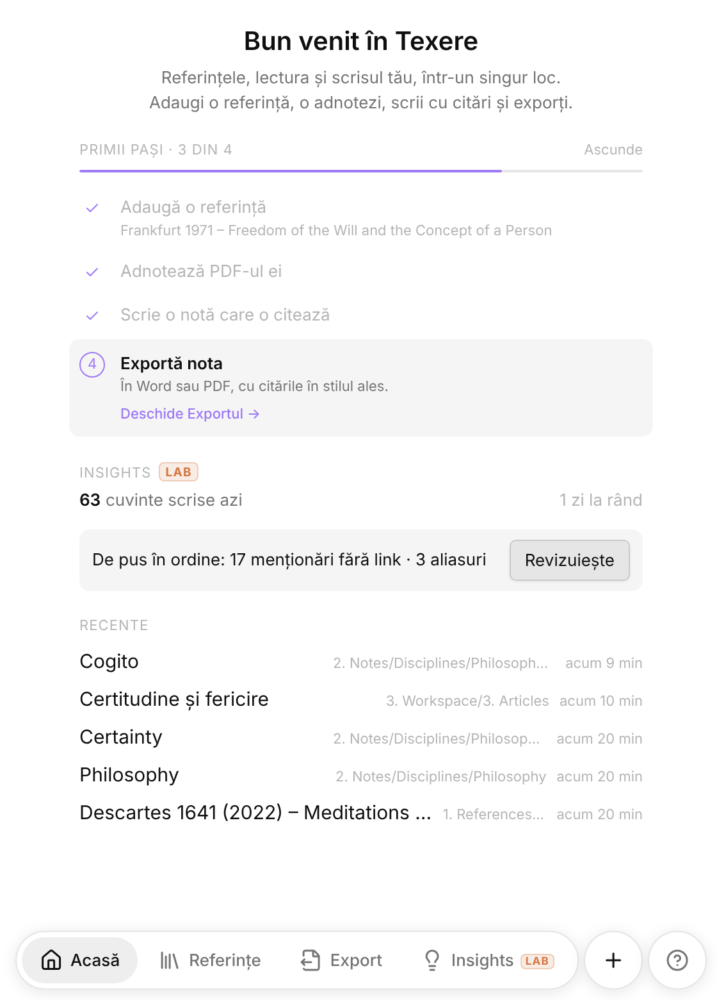

## 2. Referințe

O referință se adaugă căutând după autor, titlul articolului sau al cărții, ISBN ori DOI, lipind un BibTeX sau din biblioteca ta Zotero. Fiecare referință devine o notă de lectură, iar PDF-ul îl descarcă Texere atunci când îl găsește. Dacă nu îl găsește, îl adaugi tu.

Pentru ca Texere să comunice cu Zotero, activează **Allow other applications on this computer to communicate with Zotero** din setările avansate ale lui Zotero (**Zotero → Preferences/Settings → Advanced**).

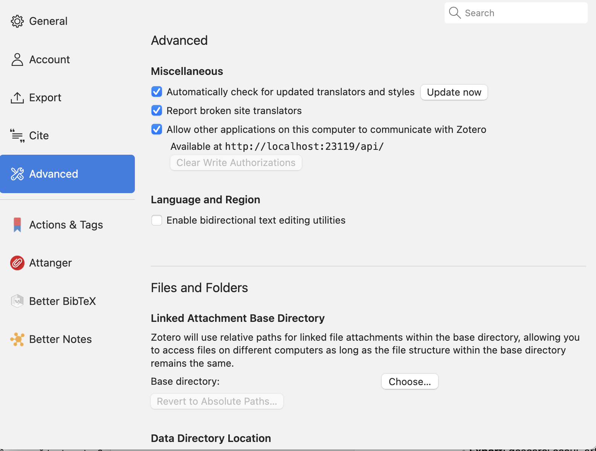

Cum funcționează:
- **Caută**: scrii titlul, autorul, DOI-ul sau ISBN-ul, iar Texere caută în cataloage academice deschise precum OpenAlex, Crossref, Semantic Scholar și Google Books. Pentru fiecare rezultat vezi anul, revista, numărul de citări și dacă PDF-ul e gratuit. Butonul **Adaugă în seif** aduce metadatele (autor, titlu, an, revistă, DOI) împreună cu PDF-ul, dacă există.

  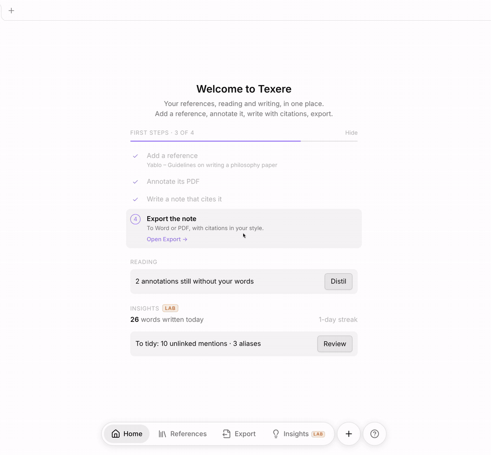

- **Zotero**: îți vezi biblioteca din Zotero și bifezi ce vrei să adaugi. **Importă referințele** aduce doar metadatele, iar **Importă referințele și PDF-urile** aduce și PDF-urile, cu evidențierile și adnotările făcute în Zotero.

  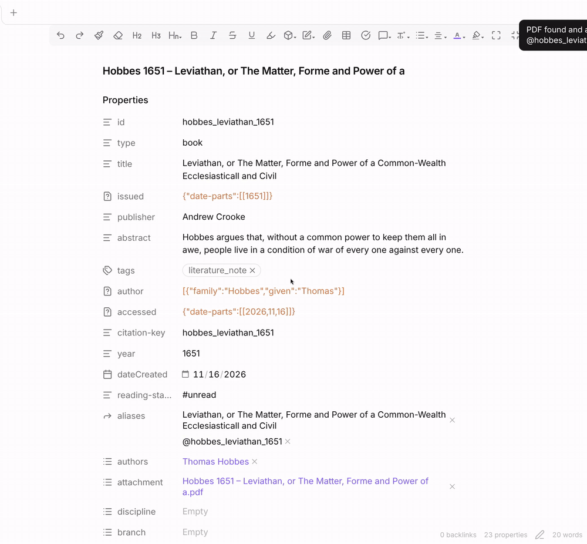

- **Alte variante**: poți lipi o citare, un BibTeX sau un DOI, poți completa metadatele de mână sau poți salva o referință din browser prin Zotero Connector.

**Avantaje**: referința, PDF-ul și notițele tale stau împreună, în fișiere Markdown, pe calculatorul tău.

## 3. Lectura și adnotările

PDF-urile se citesc și se adnotează direct în Obsidian. Fiecare culoare are o etichetă, iar pasajul pe care îl subliniezi ajunge automat în nota de lectură, cu pagina, citarea și un link înapoi la locul exact din PDF.

Cum funcționează:
1. Deschizi PDF-ul în paralel cu nota de lectură.
2. Alegi o culoare și selectezi un pasaj.
3. Pasajul este adăugat automat în notă.

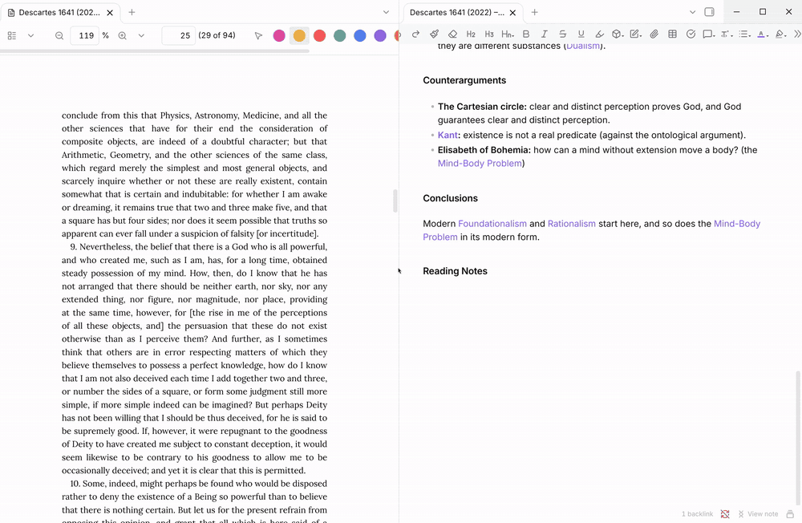

| Culoare | Etichetă | Ce marchezi |
| --- | --- | --- |
| roz | `#fact` | fapte, date, cifre |
| galben | `#claim` | afirmațiile autorului |
| roșu | `#disagree` | cu ce nu ești de acord |
| turcoaz | `#agree` | cu ce ești de acord |
| albastru | `#connection` | legături cu alte texte |
| mov | `#question` | întrebări |
| portocaliu | `#definition` | definiții |
| gri | `#word` | termeni de reținut |

**Avantaje**: într-un cititor de PDF obișnuit, sublinierile rămân în fișier. Aici devin notițe pe care le poți căuta în toate lecturile, de exemplu tot ce ai marcat cu `#disagree`. Culoarea pe care o alegi în timp ce citești este deja o primă judecată asupra textului. Sub fiecare pasaj poți scrie una sau două propoziții cu cuvintele tale (**Distilează**), astfel că atunci când începi să scrii, materialul este deja sortat și citat.

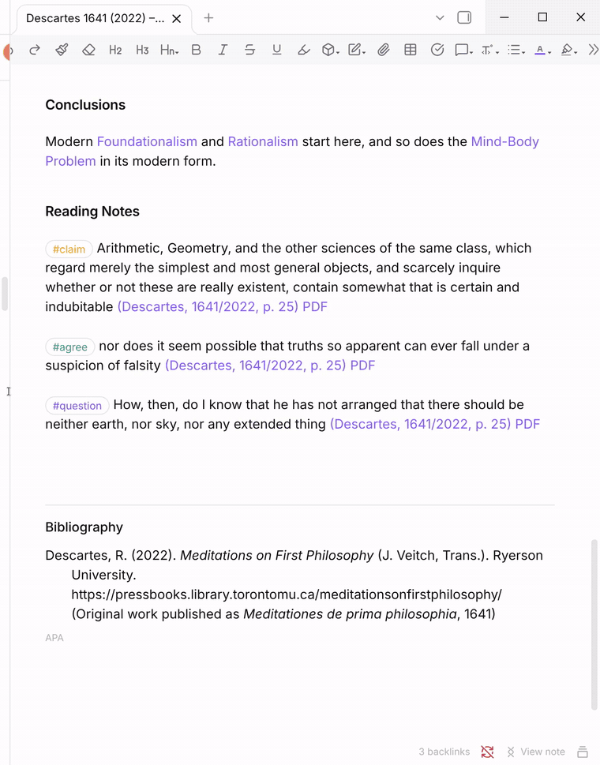

Fiecare culoare are și o scurtătură, de la **Alt+1** la **Alt+8** (**Option** pe Mac), în ordinea din tabel. Cu text selectat, îl evidențiază în culoarea aceea, iar fără selecție alege culoarea pentru următoarea evidențiere. Dacă preferi să subliniezi în loc să evidențiezi, apasă butonul cu marker de imediat după culori sau **Alt+U**. Culorile trag atunci o linie sub text, cu aceleași etichete, iar același buton te întoarce la evidențiere.

Dacă vrei doar să citești, **pointerul** din bara PDF-ului (sau tasta **H**) îți permite să selectezi textul ca să urmărești rândul, fără ca acesta să fie copiat în notă.

## 4. Harta filosofiei

Texere vine cu o hartă a filosofiei, cu câte o notă pentru fiecare ramură, teorie, concept, curent, perioadă și autor, pornind de la nota *Philosophy*. Notele au nume în engleză și în română, așa că dacă scrii `[[Etică` primești *Ethics*.

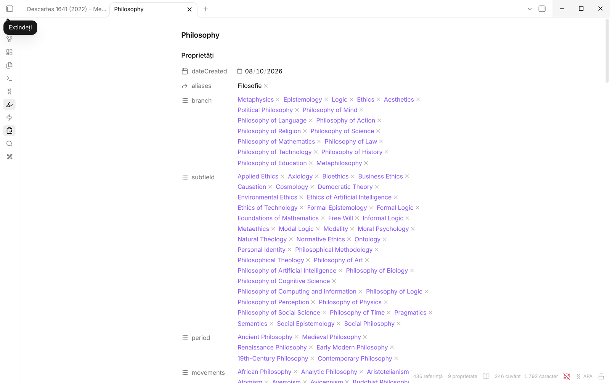

Cum funcționează: fiecare referință și fiecare notă primește câteva proprietăți (*discipline*, *branch*, concepte, autori) care trimit spre notele din hartă. O lectură marcată cu *branch: Epistemology* apare pe pagina Epistemologiei, alături de celelalte lecturi din aceeași ramură.

În graficul Obsidian, pe care îl deschizi cu **Ctrl/Cmd + G**, fiecare punct este o notă, iar liniile sunt legăturile dintre ele. Ramurile, subdomeniile, conceptele, teoriile, curentele, perioadele și autorii au fiecare culoarea lor. Culorile vin odată cu Texere, iar într-un seif mai vechi pagina de pornire ți le propune cu butonul **Adaugă**.

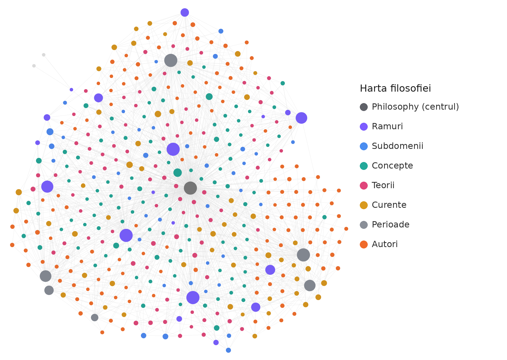

**Avantaje**: lecturile nu mai sunt ordonate doar pe foldere sau pe cursuri, ci și după ramuri și concepte. Când deschizi un concept, vezi tot ce ai citit și ai scris despre el. Harta poate fi adaptată și pentru alte discipline.

## 5. Citarea și bibliografia

Citările se adaugă direct în text, din referințele tale sau din Zotero, iar bibliografia se generează singură la finalul notei.

Cum funcționează:
1. Scrii `@` într-o notă, urmat de un cuvânt din numele autorului sau din titlu.
2. Apar referințele tale și, dacă Zotero este deschis, și cele din Zotero, marcate cu eticheta **Zotero**.

   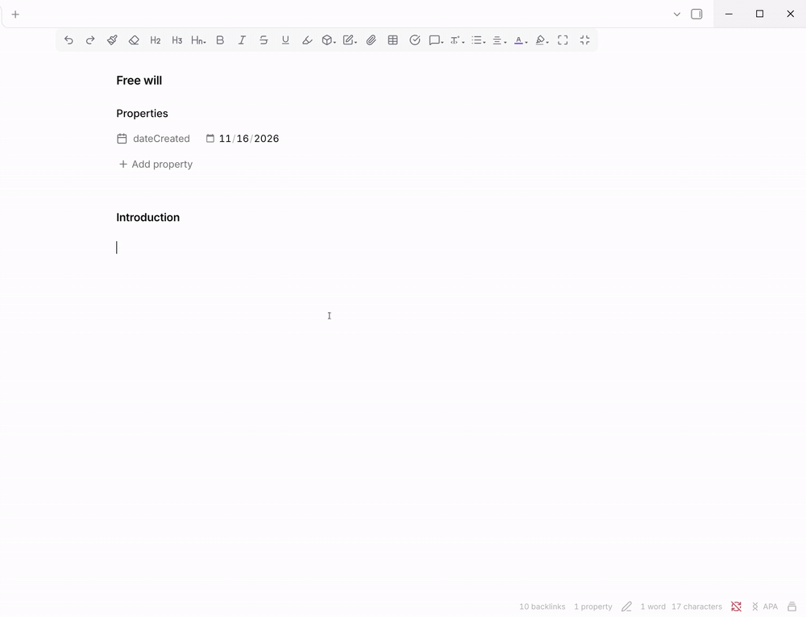

3. Alegi referința. Pentru una din Zotero poți alege între **Doar referința**, care aduce doar metadatele, și **Referința și PDF-ul**, care aduce și adnotările din Zotero.

   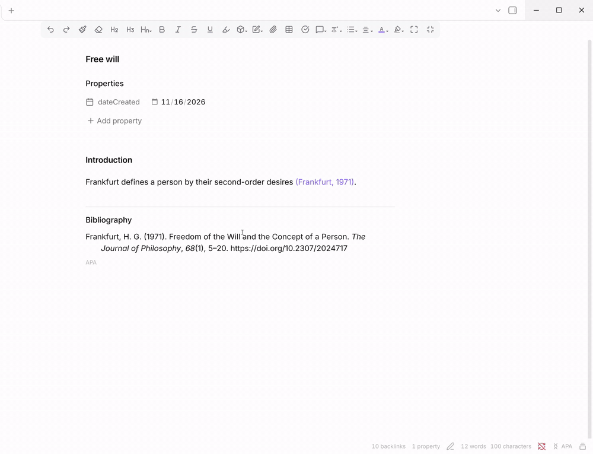

4. Adaugi pagina, de exemplu `[@descartes_meditations_2022, p. 29]`.

În notă, citarea apare formatată, de pildă *(Descartes, 1641/2022, p. 29)*. Bibliografia se actualizează pe măsură ce scrii, așa că fiecare referință citată apare imediat în ea, iar una pe care nu o mai citezi dispare.

Ca să schimbi o citare, dai clic pe ea și alegi **Editează citarea**. Poți pune altă referință sau pagina, iar bibliografia se schimbă odată cu ea.

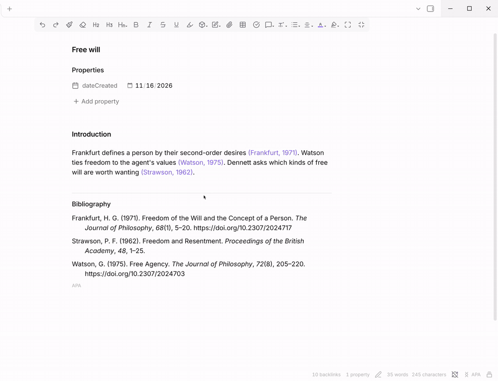

Stilul citărilor se schimbă din bara de jos. Dai clic pe **APA** și alegi alt stil (Chicago, MLA, Harvard, IEEE) sau **Adaugă un stil de citare…**, dintre peste 10.000 disponibile. Citările din text și bibliografia se refac pe loc, iar exportul folosește același stil.

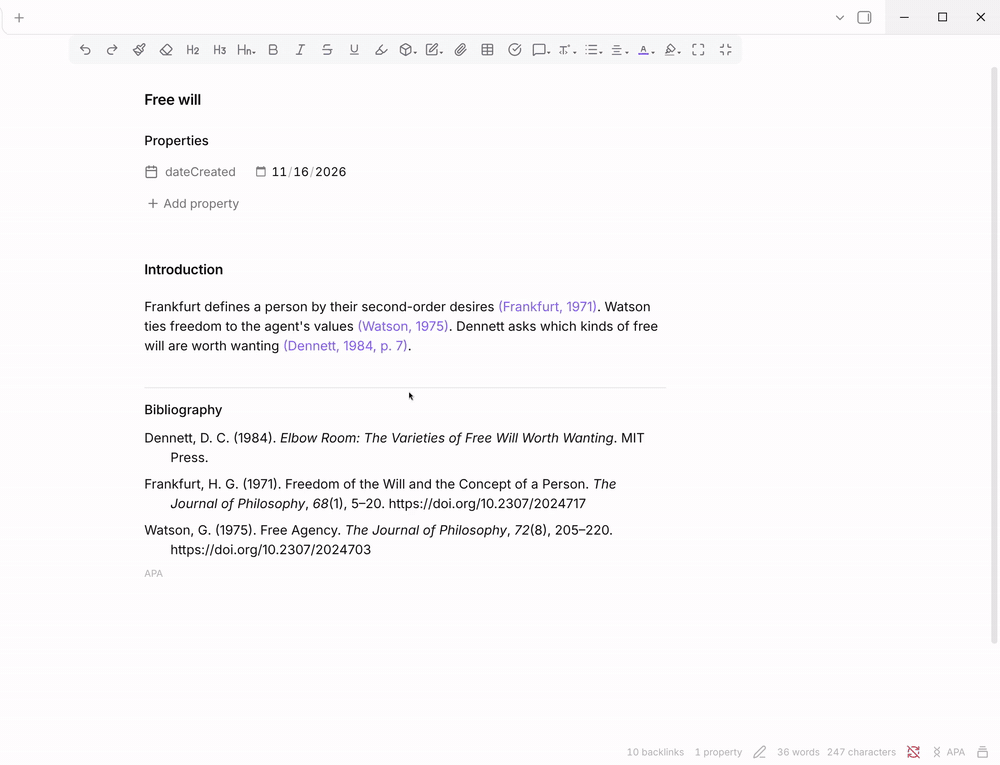

**Avantaje**: funcționează asemănător pluginului Zotero din Word, dar în același loc cu notițele și PDF-urile. Un clic pe o citare te duce la referință sau la pagina din PDF.

## 6. Exportul

Orice notă se poate exporta în PDF, Word sau Markdown, cu citările și bibliografia în stilul ales.

Cum funcționează: apeși **Export** în bara de jos, alegi **PDF**, **Word** sau **Markdown**, verifici previzualizarea și apeși **Exportă**.

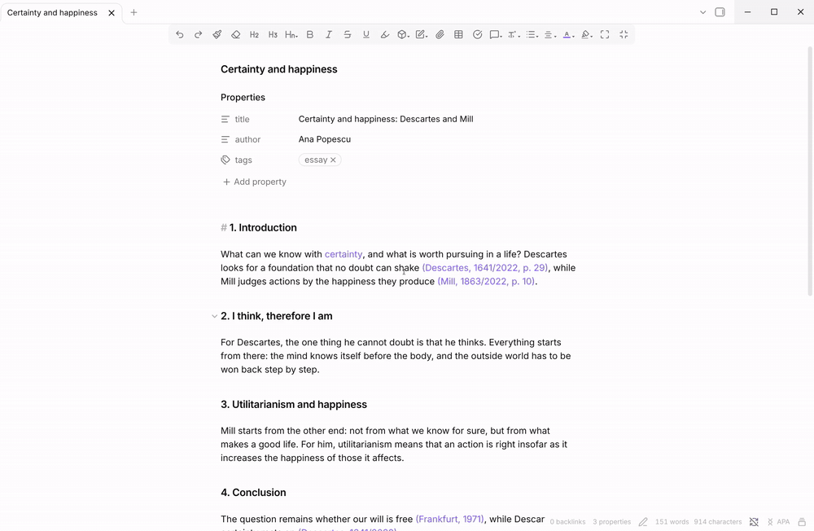

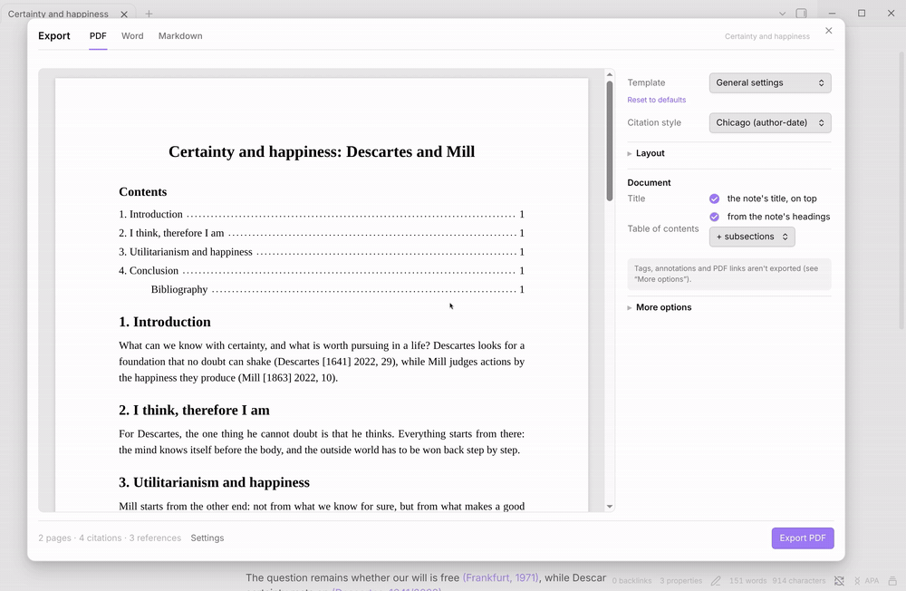
Aspectul paginii vine din șablon, care poate fi unul general sau cel al Facultății de Filosofie, după ghidul de redactare pentru licență și disertație. Cuprinsul și numerele paginilor se adaugă automat, iar fișierul Word poate fi trimis mai departe pentru corecturi, ca orice alt document.

Tot în fereastra exportului poți schimba stilul citărilor sau poți adăuga un cuprins, iar previzualizarea se schimbă pe loc.

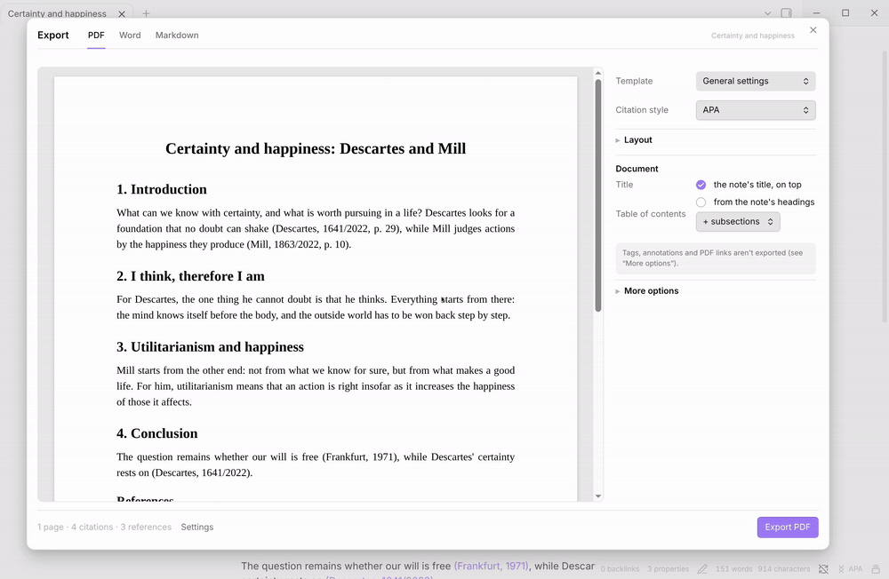

## 7. Insights (BETA)

Insights citește notele din seif și îți arată cum se leagă ideile tale. Analiza se face local, pe calculatorul tău, prin reguli de programare și fără modele de inteligență artificială.

Pentru cercetare, partea cea mai utilă este **Harta dezbaterii**. Alegi un concept, de exemplu *Happiness*, și vezi pe o singură pagină toate pasajele pe care le-ai subliniat despre el în toate lecturile. Fiecare pasaj are citarea, pagina și notița ta, iar pasajele sunt grupate după autorul sau capitolul din care provin.

Cum funcționează:
1. Deschizi harta din panoul conceptului sau din Insights, la fila **Lectura**, cu butonul **Harta dezbaterii**.
2. Alegi ce te interesează din filtrele de sus, de exemplu **Nu ești de acord** și **Afirmații și definiții**.
3. Apeși **Începe o notă din cele…**, iar Texere creează schița unui text nou cu pasajele alese, grupate pe tipuri, cu citările deja puse și cu un rând pentru răspunsul tău sub fiecare.

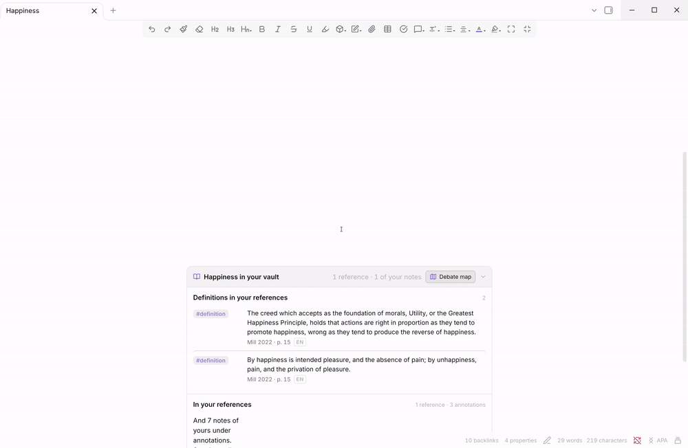
Pe lângă harta dezbaterii, Insights te mai ajută în trei feluri:
- **Linkuri lipsă**: găsește conceptele și autorii pe care i-ai menționat fără link, numele care nu au încă o notă și posibilele dubluri. **Revizuiește** le grupează, iar **Leagă selectate** pune linkurile fără să-ți schimbe textul, astfel încât *„acțiunii”* devine un link spre conceptul *Action*. Pentru un nume fără notă, **Unde apare** îți arată propozițiile în care apare, iar un nume apropiat de un autor pe care îl ai (*Granding* și *Temple Grandin*) e semnalat ca o posibilă greșeală de scriere.
- **Panoul conceptului**: în nota unui concept apar definițiile lui din referințele tale, notele în care îl folosești și conceptele alături de care apare în aceleași paragrafe.
- **Tipare**: vezi ce citești, dar nu folosești în scris, subiectele care revin des și conceptele care apar împreună fără să fie legate.

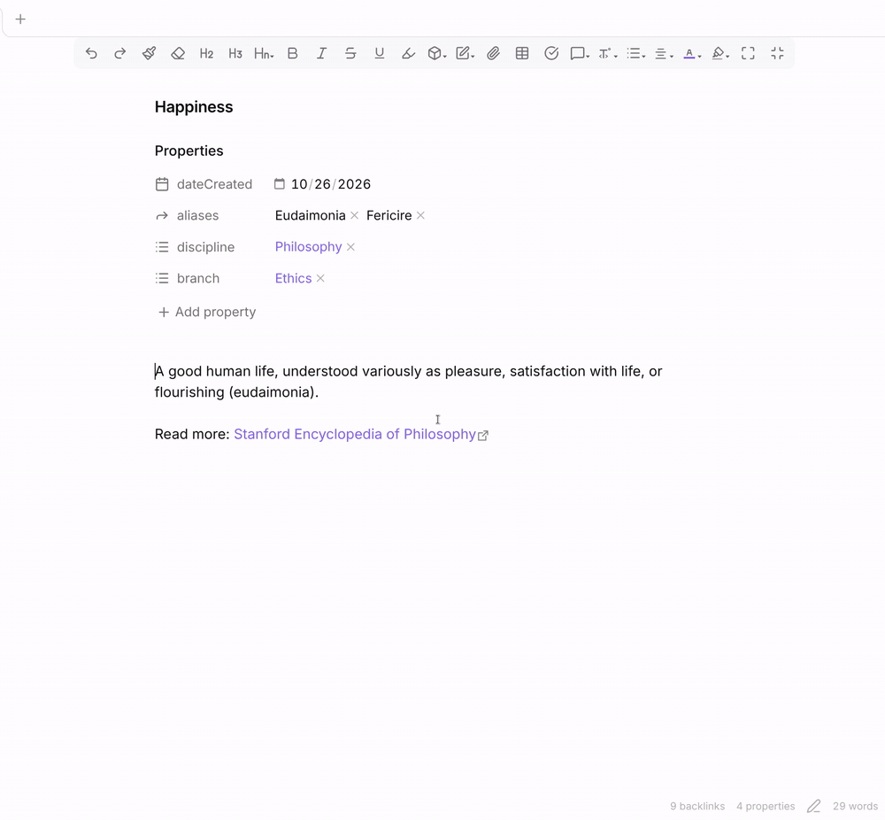
**Avantaje**: într-un folder cu documente Word, legătura dintre un text citit acum doi ani și ideea de azi depinde de memorie. În Texere, pasajele subliniate despre același concept se adună singure din toate lecturile, iar un articol nou poate porni direct de la ele.

## Mai multe detalii

- **Configurarea**: alegi limba și apeși **Înainte** până la final. Texere pregătește folderele, bibliografia și stilurile de citare, harta filosofiei, șabloanele, ghidurile de scris și PDF++, pluginul pentru adnotări. O poți rula oricând din nou, din **Settings → Texere → General**.
- **Cataloagele**: dacă un catalog îți spune că ai atins limita pe zi, adaugi o cheie gratuită în **Settings → Texere → Referințe → Cataloage**. Un PDF pe care îl ai deja devine referință cu **Ctrl/Cmd + P** și **Texere: Adaugă acest PDF ca referință**.
- **Zotero**: o referință care e deja în seif primește doar ce îi lipsește, așa că nimic nu se dublează, iar Better BibTeX nu este necesar. Cu o cheie Zotero, adăugată în **Settings → Texere → Referințe → Zotero**, importul merge și cu Zotero închis. Tot acolo pornești butonul Zotero din browser.
- **Unde intră evidențierile**: prima dată când evidențiezi într-un PDF, Texere te întreabă în ce notă intră pasajele: nota de lectură sau altă notă la care e atașat PDF-ul, cum ar fi o notă de seminar sau un eseu. Poți alege și **Nicăieri**, iar atunci evidențierile rămân doar în PDF. Nota aleasă se deschide lângă PDF și primește fiecare pasaj. Alegerea o schimbi din bara de jos a PDF-ului, unde **Adnotări →** arată nota de acum, sau cu clic dreapta pe PDF, **Texere** și **Unde intră adnotările noi…**. Evidențierile lăsate în PDF le adaugi mai târziu în oricare dintre notele lui, din aceeași bară, cu **Importă adnotările într-o notă…**, sau din notă, cu clic dreapta, **Texere** și **Importă adnotările din PDF**.
- **Adnotările**: o evidențiere o ștergi fie din notă, fie din PDF, iar ea dispare din ambele locuri. Adnotările făcute în altă aplicație, cum ar fi Zotero, Preview sau Acrobat, intră și ele în notă, iar pe cele făcute mai târziu le aduci cu clic dreapta pe notă, **Texere** și **Importă adnotările din PDF**.
- **Culorile din grafic**: dacă lipsesc, le adaugi cu **Ctrl/Cmd + P** și **Texere: Culori în grafic pentru harta disciplinei**.
- **Citările**, pe scurt:

  | Scrii | Primești (APA) |
  | --- | --- |
  | `[@descartes_meditations_2022, p. 29]` | (Descartes, 1641/2022, p. 29) |
  | `[@descartes_meditations_2022; @mill_utilitarianism_2022]` | (Descartes, 1641/2022; Mill, 1863/2022) |
  | `@descartes_meditations_2022 [p. 29]` | Descartes (1641/2022, p. 29) |

- **Exportul**: un șablon al tău îl faci în **Settings → Texere → Export**, iar folderul în care ajung fișierele îl alegi în **Settings → Texere → General → Foldere**. Cuprinsul îl pui unde vrei cu clic dreapta în notă, **Texere** și **Pune cuprinsul aici**.
- **Scrisul**: în fila **Scrisul** din Insights vezi cât scrii și cum scrii, iar **Verifică ciorna**, din **Însoțitorul scrisului** (clic dreapta pe notă și **Texere**), îți arată ce face fiecare paragraf și ce mai lipsește, după ghidurile de scris din Texere.

## Actualizări și ajutor

Texere caută singur versiunile noi și ți le arată pe pagina de pornire, de unde le instalezi cu **Actualizează**. În Obsidian, butonul **?** de pe pagina de pornire deschide ghidul și întrebările frecvente. Pentru o problemă sau o idee: **Settings → Texere → Despre → Semnalează o problemă**, sau scrie la [hi@georgemihai.com](mailto:hi@georgemihai.com). Toate versiunile: [CHANGELOG](CHANGELOG.md).

## Licență și autor

Texere e făcut de [George Mihai](https://www.georgemihai.com/?utm_source=texere&utm_medium=github_plugin&utm_campaign=texere) ([hi@georgemihai.com](mailto:hi@georgemihai.com)). Codul e sub licența MIT, iar ghidurile și harta filosofiei sub CC BY 4.0 (vezi [LICENSE](LICENSE)). Ce conectează Texere la internet și ce citește de pe calculatorul tău e descris, în engleză, în [README](README.md#privacy).
