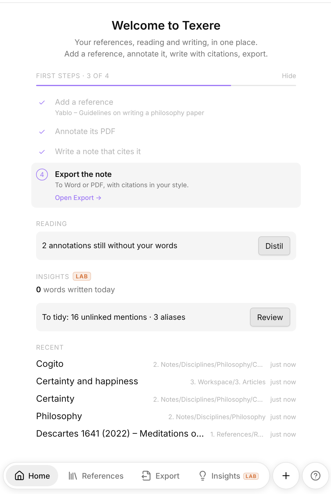
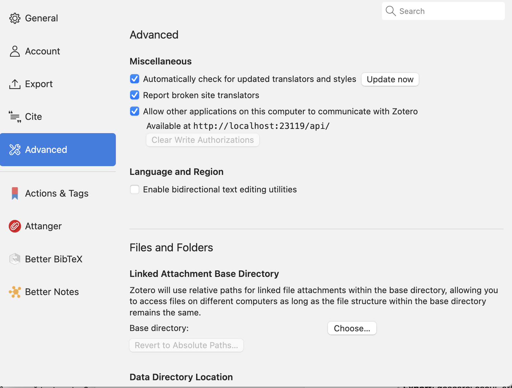
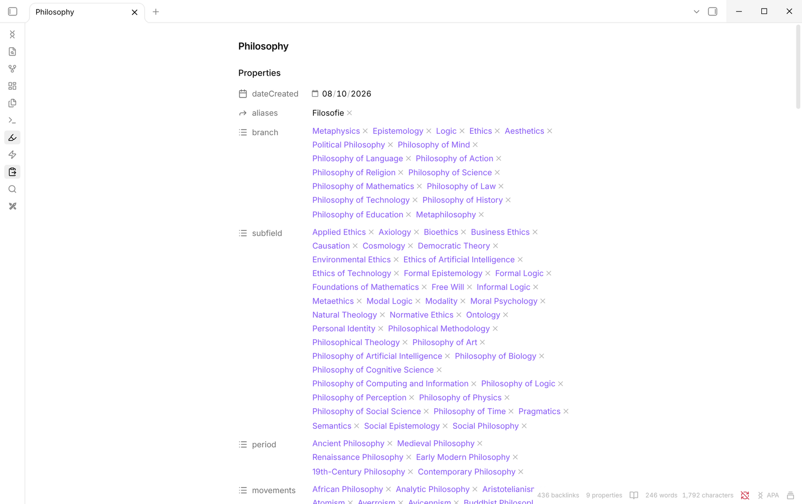
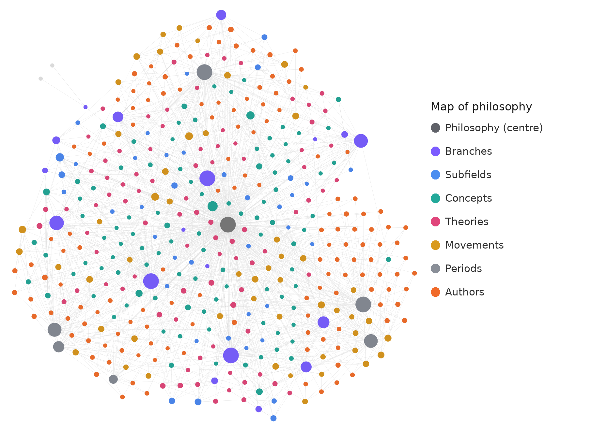

## 1. Start

Texere is a free Obsidian plugin that brings the references, the reading and the writing of a research paper together in one place.

Research is usually split across several applications:
- Zotero or Mendeley for references
- a PDF reader for annotations
- Word for writing

Information gets lost on the way between them: a highlighted passage stays in the PDF, an idea noted two years ago can no longer be found, and a citation has to be checked once more in the text. Texere links these steps together, and Zotero can remain your database.

### 1.1 Installing

The Texere plugin installs with the same steps on Windows and on Mac:
1. Install [Obsidian](https://obsidian.md/download) and create a new vault. If you already have a vault in Obsidian, go on from step 2.
2. In **Settings → Community plugins** click **Turn on community plugins**, then install and enable the **BRAT** plugin.
3. From the command palette (**Ctrl/Cmd + P**) choose **BRAT: Add a beta plugin**, paste `gorgmihai92/texere-plugin` and click **Add plugin**.
4. Texere prepares everything by itself. In an existing vault it only adds what it needs to work properly, without moving anything you have.

During the setup you choose your language and click **Next** until the end. Texere prepares the folders, the bibliography and citation styles, the map of philosophy, the templates, the writing guides and PDF++, the plugin for annotations. You can run the setup again at any time from **Settings → Texere → General**.

### 1.2 The home page

Texere's home page opens from the braided icon at the top left or from any new tab (+). Its bottom bar takes you to the four parts of the plugin:

- **Home**: your first steps, your recent notes and what's new in Texere.
- **References**: you search for and add works from online catalogs or from Zotero.
- **Export**: you get your essay, article or thesis as PDF, Word or Markdown, with the citations and bibliography in the style you chose.
- **Insights**: statistics about what you write and read, together with the links between ideas.

The **?** button next to the bar opens this Help, where you can type your question in your own words.

### 1.3 Obsidian in a few words

Obsidian works with text files on your computer, with no account and no cloud. Each note is an `.md` file. On the left you have your files and search, in the middle your open notes in tabs, and on the right information about the open note, for example **Backlinks**, the notes that link to it. Type `[[` to link one note to another, and **Ctrl/Cmd + P** opens the list of all commands. **Ctrl/Cmd + Shift + D** hides everything except your open notes, so you can focus.

### 1.4 Shortcuts

| Shortcut | What it does |
| --- | --- |
| **Ctrl/Cmd + P** | the list of all commands, Texere's included |
| `@` in a note | your references and those from Zotero, to cite one |
| **Alt + 1** … **Alt + 8** | in a PDF: highlights the selection in that colour, or picks the colour for the next highlight |
| **Alt + U** | in a PDF: underline instead of highlight, and back |
| **H** | in a PDF: the pointer, to select text without copying it into the note |
| **Ctrl/Cmd + Shift + D** | only your open notes stay in view, and the second time everything comes back |
| **Ctrl/Cmd + 1** … **4** | in the window for adding a reference: Search, Zotero, Paste and Enter manually |
| **Ctrl/Cmd + Enter** | in Distil, saves what you wrote, and in Cuts, puts the passage back in the note |
| **Ctrl + Cmd + ← →** on a Mac, **Ctrl + Alt + Shift + ← →** on Windows | in Edit mode: goes through the versions |
| **Ctrl + Cmd + ↑ ↓** on a Mac, **Ctrl + Alt + Shift + ↑ ↓** on Windows | in Edit mode: the next place with versions |
| **Ctrl + Cmd + ⌫** on a Mac, **Ctrl + Alt + Shift + ⌫** on Windows | in Edit mode: deletes the version you see |

On a Mac, **Alt** is the **Option** key. You change any of them in **Settings → Hotkeys**, where you search for *Texere*.

## 2. References and reading

### 2.1 Adding a reference

You add a reference by searching for the author, the title of the article or book, the ISBN or DOI, by pasting a BibTeX entry, or from your Zotero library. Each reference becomes a reading note in **Reading Notes**, and Texere downloads the PDF when it finds one. If it doesn't, you add it yourself.

For Texere to talk to Zotero, turn on **Allow other applications on this computer to communicate with Zotero** in Zotero's advanced settings (**Zotero → Preferences/Settings → Advanced**).

How it works:
- **Search**: type the title, author, DOI or ISBN, and Texere searches open academic catalogs such as OpenAlex, Crossref, Semantic Scholar and Google Books. For each result you see the year, the journal, the number of citations and whether the PDF is free. **Add to vault** brings the metadata (author, title, year, journal, DOI) together with the PDF, when there is one.

  <video src="https://raw.githubusercontent.com/gorgmihai92/texere-plugin/main/docs/clips/search.mp4" title="Searching a catalog and adding a reference" autoplay muted loop playsinline style="width:100%;border-radius:8px"></video>

- **Zotero**: you see your Zotero library and tick what you want to add. **Import references** brings only the metadata, while **Import references and PDFs** also brings the PDFs, with the highlights and annotations you made in Zotero, each tagged by its colour.

  <video src="https://raw.githubusercontent.com/gorgmihai92/texere-plugin/main/docs/clips/zotero.mp4" title="Importing references and PDFs from Zotero" autoplay muted loop playsinline style="width:100%;border-radius:8px"></video>

- **Other ways**: you can paste a citation, a BibTeX entry or a DOI, fill in the metadata by hand, save a reference from your browser with Zotero Connector, or turn a PDF you already have into a reference, with **Ctrl/Cmd + P** and **Texere: Add this PDF as a reference**.

**Why it helps**: the reference, the PDF and your notes stay together, in Markdown files, on your computer.

A Zotero reference already in your vault only gets what it is missing, so nothing is doubled, and Better BibTeX is not needed. Zotero has to be open, but with a Zotero key, added in **Settings → Texere → References → Zotero**, importing works with Zotero closed too. That is also where you turn on the Zotero browser button, so that an article saved with Zotero Connector goes straight into your vault. If a catalog says you've reached its daily limit, add a free key in **Settings → Texere → References → Catalogs**.

### 2.2 Reading and annotating

You read and annotate PDFs right in Obsidian. Each colour has a tag, and the passage you highlight goes into the reading note by itself, with the page, the citation and a link back to the exact place in the PDF.

How it works:
1. Open the PDF next to the reading note.
2. Choose a colour and select a passage.
3. The passage is added to the note by itself.

<video src="https://raw.githubusercontent.com/gorgmihai92/texere-plugin/main/docs/clips/highlight.mp4" title="Highlighting passages in a PDF, which go into the reading note" autoplay muted loop playsinline style="width:100%;border-radius:8px"></video>

| Colour | Tag | What you mark |
| --- | --- | --- |
| pink | `#fact` | facts, dates, figures |
| yellow | `#claim` | the author's claims |
| red | `#disagree` | what you disagree with |
| teal | `#agree` | what you agree with |
| blue | `#connection` | links to other texts |
| purple | `#question` | questions |
| orange | `#definition` | definitions |
| grey | `#word` | terms to remember |

**Why it helps**: in an ordinary PDF reader, highlights stay in the file. Here they become notes you can search across all your readings, for example everything you marked `#disagree`. The colour you choose while reading is already a first judgement about the text. Under each passage you can write one or two sentences in your own words (**Distil**, from the home page), so that when you start writing, your material is already sorted and cited.

<video src="https://raw.githubusercontent.com/gorgmihai92/texere-plugin/main/docs/clips/own-words.mp4" title="Writing a sentence in your own words under a passage" autoplay muted loop playsinline style="width:100%;border-radius:8px"></video>

Each colour also has a shortcut, from **Alt+1** to **Alt+8** (**Option** on a Mac), in the order of the table. With text selected, it highlights it in that colour. Without a selection, it picks the colour for the next highlight. If you'd rather underline than highlight, click the highlighter button right after the colours, or press **Alt+U**. The colours then draw a line under the text, with the same tags, and the same button takes you back to highlighting.

The first time you highlight in a PDF, Texere asks which note the passages go into: the reading note or another note the PDF is attached to, such as a seminar note or an essay. You can also choose **Nowhere**, and then the highlights stay only in the PDF. Texere saves each passage in that note in the background, without opening it, and if the note is open, you see the passage appear. You change the choice from the PDF's bottom bar, where **Annotations →** shows the current note, or with a right-click on the PDF, **Texere** and **Where new annotations go…**. The highlights you left in the PDF you add later to any of its notes, from the same bar with **Import annotations into a note…**, or from the note itself, with a right-click, **Texere** and **Import annotations from PDF**.

If you only want to read, the **pointer** in the PDF's toolbar (or the **H** key) lets you select text to follow the line, without it being copied into the note. You delete a highlight either from the note or from the PDF, and it disappears from both. Annotations made in another app, such as Zotero, Preview or Acrobat, come into the note too, and the ones made later you bring in with a right-click on the note, **Texere** and **Import annotations from PDF**.

## 3. Writing

### 3.1 The map of philosophy

Texere comes with a map of philosophy, with a note for each branch, theory, concept, movement, period and author, starting from the *Philosophy* note. The notes have English names and Romanian aliases, so typing `[[Etică` gives you *Ethics*.

How it works: each reference and each note gets a few properties (*discipline*, *branch*, concepts, authors) that point to notes in the map. A reading marked *branch: Epistemology* shows up on the Epistemology page, next to the other readings in the same branch.

In the Obsidian graph, which you open with **Ctrl/Cmd + G**, each dot is a note and the lines are the links between them. Branches, subfields, concepts, theories, movements, periods and authors each have their own colour. The colours come with Texere, and in an older vault the home page offers them with the **Add** button. You can also add them at any time with **Ctrl/Cmd + P** and **Texere: Colours in the graph for the discipline map**.

**Why it helps**: your readings are no longer ordered only by folders or courses, but also by branches and concepts. When you open a concept, you see everything you have read and written about it. The map can be adapted to other disciplines too.

### 3.2 Citations and bibliography

You add citations right in the text, from your references or from Zotero, and the bibliography builds itself at the end of the note.

How it works:
1. Type `@` in a note, followed by a word from the author's name or the title.
2. Your references appear and, if Zotero is open, those from Zotero too, marked with the **Zotero** label.

   <video src="https://raw.githubusercontent.com/gorgmihai92/texere-plugin/main/docs/clips/cite.mp4" title="Citing a reference with @" autoplay muted loop playsinline style="width:100%;border-radius:8px"></video>

3. Choose the reference. For one from Zotero you can choose between **Reference only**, which brings only the metadata, and **Reference and PDF**, which also brings the annotations from Zotero.

   <video src="https://raw.githubusercontent.com/gorgmihai92/texere-plugin/main/docs/clips/cite-zotero.mp4" title="Citing a reference from Zotero" autoplay muted loop playsinline style="width:100%;border-radius:8px"></video>

4. Add the page, for example `[@descartes_meditations_2022, p. 29]`.

In the note, the citation shows formatted, for example *(Descartes, 1641/2022, p. 29)*. The bibliography updates as you write, so each reference you cite appears in it at once, and one you no longer cite disappears.

To change a citation, click it and choose **Edit the citation**: you can swap the reference or add the page, and the bibliography follows.

<video src="https://raw.githubusercontent.com/gorgmihai92/texere-plugin/main/docs/clips/fix-citation.mp4" title="Changing the reference of a citation and adding the page" autoplay muted loop playsinline style="width:100%;border-radius:8px"></video>

You change the citation style from the bottom bar. Click **APA** and choose another style (Chicago, MLA, Harvard, IEEE) or **Add a citation style…**, from more than 10,000 available. The citations in the text and the bibliography are redone on the spot, and the export uses the same style.

<video src="https://raw.githubusercontent.com/gorgmihai92/texere-plugin/main/docs/clips/style.mp4" title="Switching the citation style from APA to Chicago" autoplay muted loop playsinline style="width:100%;border-radius:8px"></video>

| You type | You get (APA) |
| --- | --- |
| `[@descartes_meditations_2022, p. 29]` | (Descartes, 1641/2022, p. 29) |
| `[@descartes_meditations_2022; @mill_utilitarianism_2022]` | (Descartes, 1641/2022; Mill, 1863/2022) |
| `@descartes_meditations_2022 [p. 29]` | Descartes (1641/2022, p. 29) |

**Why it helps**: it works much like the Zotero plugin for Word, but in the same place as your notes and PDFs. A click on a citation takes you to the reference or to the page in the PDF.

### 3.3 Templates and writing guides

Papers start easily from a template in **Support/Templates**: **New essay** for an essay or article, **Licență** and **Disertație** for BA and MA theses at the Faculty of Philosophy of the University of Bucharest, following the faculty's writing guide. In **Support/Texere/Guides** you'll find the writing guides (**Getting started in philosophy**, with its Romanian version), their sources and the faculty's writing guide.

### 3.4 Edit mode

When you have a draft, **Edit mode** helps you rework it without losing anything. You try versions of a word, a sentence or a paragraph right in the note, and nothing is final until you choose.

<video src="https://raw.githubusercontent.com/gorgmihai92/texere-plugin/main/docs/clips/edit-mode.mp4" title="Trying a version of a sentence, dimming a passage and moving one to Cuts" autoplay muted loop playsinline style="width:100%;border-radius:8px"></video>

How it works:
1. Turn it on with ✎ at the top of the note, or with a right-click on the note, **Texere** and **Edit mode**.
2. Select a word, a sentence or a paragraph and choose **Versions**. Write a version, press **Enter** and click any version to see it in the page. **Keep what's showing** keeps the one you chose, and the original stays in the list until then.
3. **Dim** fades a passage, so you can read the page without it, and a click brings it back. **Move to Cuts** takes it out of the text and keeps it in **Cuts**, from where you can bring it back at any time.
4. The **Texere** button marks long sentences, hedges or claims stated too strongly, following the writing guides, without AI.
5. Click **Done** when you have finished.

## 4. Export

Any note can be exported to PDF, Word or Markdown, with the citations and bibliography in the style you chose.

How it works: click **Export** in the bottom bar, choose **PDF**, **Word** or **Markdown**, check the preview and click **Export**.

<video src="https://raw.githubusercontent.com/gorgmihai92/texere-plugin/main/docs/clips/export.mp4" title="Opening the export window and checking the preview" autoplay muted loop playsinline style="width:100%;border-radius:8px"></video>

<video src="https://raw.githubusercontent.com/gorgmihai92/texere-plugin/main/docs/clips/export-formats.mp4" title="Switching between PDF, Word and Markdown, then exporting" autoplay muted loop playsinline style="width:100%;border-radius:8px"></video>
The page layout comes from the template, which can be a general one or the Faculty of Philosophy's, following the writing guide for BA and MA theses. The table of contents and page numbers are added by themselves, and the Word file can be sent on for corrections like any other document.

In the same window you can change the citation style or add a table of contents, and the preview follows.

<video src="https://raw.githubusercontent.com/gorgmihai92/texere-plugin/main/docs/clips/export-style.mp4" title="Changing the citation style and adding a table of contents in the export" autoplay muted loop playsinline style="width:100%;border-radius:8px"></video>

You make a template of your own in **Settings → Texere → Export**, and you choose the folder the files go to in **Settings → Texere → General → Folders**. You put the table of contents where you want it with a right-click in the note, **Texere** and **Insert the contents here**.

## 5. Insights (BETA)

Insights reads the notes in your vault and shows you how your ideas link together. The analysis runs locally, on your computer, with programming rules and no artificial intelligence models.

For research, the most useful part is the **Debate map**. You choose a concept, for example *Happiness*, and see on a single page every passage you highlighted about it, across all your readings. Each passage has its citation, page and your note, and the passages are grouped by the author or chapter they come from.

How it works:
1. Open the map from the concept panel or from Insights, in the **Reading** tab, with the **Debate map** button.
2. Choose what interests you with the filters at the top, for example **You disagree** and **Claims and definitions**.
3. Click **Start a note from these…**, and Texere creates the draft of a new text with the passages you chose, grouped by kind, with the citations already in place and a line for your answer under each one.

<video src="https://raw.githubusercontent.com/gorgmihai92/texere-plugin/main/docs/clips/debate-map.mp4" title="Filtering the debate map and starting a note from the passages" autoplay muted loop playsinline style="width:100%;border-radius:8px"></video>
Besides the debate map, Insights helps you in three more ways:
- **Missing links**: it finds the concepts and authors you mentioned without a link, the names that don't have a note yet and possible duplicates. **Review** groups them, and **Link selected** adds the links without changing your text, so that *“actions”* becomes a link to the concept *Action*. For a name without a note, **Where it's used** shows the sentences where it appears, and a name close to an author you have (*Granding* and *Temple Grandin*) is marked as a possible misspelling.
- **Concept panel**: in a concept's note you see its definitions from your references, the notes where you use it and the concepts it appears with in the same paragraphs.
- **Patterns**: you see what you read but don't use in your writing, the topics that keep coming back and the concepts that appear together without being linked.

<video src="https://raw.githubusercontent.com/gorgmihai92/texere-plugin/main/docs/clips/concept.mp4" title="The concept panel: linking a mention and reading the definitions" autoplay muted loop playsinline style="width:100%;border-radius:8px"></video>
The **Writing** tab shows how much and how you write, and **Check this draft**, in the **Writing companion** (right-click on a note and **Texere**), shows what each paragraph does and what is still missing, following Texere's writing guides.

**Why it helps**: in a folder of Word documents, the link between a text read two years ago and today's idea depends on memory. In Texere, the passages you highlighted about the same concept gather by themselves from all your readings, and a new article can start straight from them.

## 6. When something goes wrong

### 6.1 What to do first

Open a new tab or **Settings → Texere**. Both show what is missing, with a button that fixes it. If it still doesn't work, run the setup again from **Settings → Texere → General**, and if the problem stays, write to us from **Settings → Texere → About → Report a problem**. Every now and then, copy your vault folder to an external drive, so you have a backup.

### 6.2 Common problems

| What you see | What to do |
| --- | --- |
| no plugin starts (“Restricted mode”) | **Settings → Community plugins → Turn on community plugins** |
| citations stay `[@citekey]` | turn on the **References** module in **Settings → Texere → General** |
| Zotero references don't show up after `@` | open Zotero and tick in its settings, under **Advanced**, **Allow other applications on this computer to communicate with Zotero** |
| a message about Better BibTeX | it comes from another plugin, such as Zotero Integration. Texere doesn't need it, and **How to fix it** in the message shows you the steps |
| a highlight doesn't reach the note | the pointer is on: press **H** or choose a colour |
| “PDF++: An error occurred while attempting to add an annotation” | the PDF is locked by its publisher. Texere unlocks it by itself when you open it, and if it has a password, it tells you what to do |
| annotations are missing from the note | right-click on the note, **Texere** and **Import annotations from PDF** |
| “limit reached” when searching | add a free key in **Settings → Texere → References → Catalogs** |
| you can't find the exported file | check the export folder in **Settings → Texere → General → Folders** |

### 6.3 Manual setup

If the setup couldn't do a step, you do it yourself, by hand:

1. **Plugins**: in **Settings → Community plugins** click **Turn on community plugins**.
2. **Modules**: in **Settings → Texere → General → Modules** turn on References and Export.
3. **PDF++**: in **Settings → Texere → General → Advanced** click **Open its page**, then **Install** and **Enable**, or **Turn on**, if it is already installed.
4. **Bibliography**: in **Settings → Texere → References → Notes & citations**, the **Note tag** has to be `literature_note`, then click **Advanced → Bibliography → Rebuild from notes**.
5. **Export folder**: choose it in **Settings → Texere → General → Folders → Export folder**.
6. **Templates and guides**: **Settings → Texere → General → Advanced → Templates and writing guides** adds the missing ones without touching yours.

## 7. What's new

Texere looks for new versions by itself. When there is one, the home page shows it, and you install it with **Update** and **Reload**. What a version brings for your vault, for example a new template, is only offered to you, with **Add** or **Not now**. Every version is on [Texere's page](https://github.com/gorgmihai92/texere-plugin/blob/main/CHANGELOG.md).

**0.5.10** · 27 November 2026
- **Searching Zotero with `@` is instant.** Texere reads your Zotero library once, in the background, as soon as Obsidian opens, and searches it as you type, instead of asking Zotero at every key. After that it only asks Zotero what changed, so a reference you have just added in Zotero shows up at once.
- **Names written with LaTeX accents** in Zotero (such as „Vic\ua”) show properly („Vică”).

**0.5.9** · 18 November 2026
- **Underlining stays in the PDF.** Colours and underline in notes are gone, so a note keeps plain Markdown.

**0.5.8** · 18 November 2026
- **Alt + 1…8 and Alt + U work on every keyboard**, also on a Mac where Option + a key types a character.
- **Highlighting and deleting a highlight are about twice as fast** in large PDFs.

**0.5.7** · 18 November 2026
- **Alt + U works on a Mac too**, to switch between underlining and highlighting in a PDF.
- **The underline sits under the text**, no longer through the letters with a tail.
- **Harder PDFs are annotated exactly.** In printed books with joined letters, or where the hidden text doesn't sit on the letters you see, Texere recognises the page and puts the highlight or underline exactly on the words you selected.

**0.5.6** · 18 November 2026
- **Underline instead of highlight:** a button after the colours, or Alt+U, with the same colours and tags.
- **Edit mode** has a short clip in Help and its own section in the README, and the **Cuts** button opens the panel at the first click.
- **All the shortcuts in one table** (1.4).
- **The note no longer opens** when you highlight: the passages are saved in it in the background, and highlighting is quicker.

**0.5.5** · 18 November 2026
- **Shortcuts for the colours:** Alt+1 to Alt+8, one for each highlight colour.
- **You choose where highlights go:** at the first highlight in a PDF, into one of the notes it is attached to or nowhere. The passages are saved in the chosen note, and you change the choice from the PDF's bottom bar.
- **A PDF linked from several notes** no longer stops highlighting, and highlights left in the PDF can be added later to any of its notes.
- **Names without a note:** see where each name is used, and words at the start of a sentence are no longer taken for names.

**0.5.4** · 16 November 2026
- **Help shows each step as a short clip:** searching, importing from Zotero, highlighting, citing, changing a citation, exporting and Insights.

**0.5.3** · 16 November 2026
- **Locked PDFs can be highlighted:** a PDF locked by its publisher (no password) is unlocked when you open it, without damaging its bookmarks. When a highlight can't be written, the message tells you why and what to do.

**0.5.2** · 16 November 2026
- **In Romanian, “seif” instead of “vault”** throughout Texere, and the English guide has its own English pictures.

**0.5.1** · 16 November 2026
- **A shorter Help:** the guide and the frequent questions follow the getting-started tutorial, briefly and with pictures.

**0.5.0** · 16 November 2026
- **One way in, just the plugin:** Texere installs through BRAT in any vault, empty or with your notes, on Windows and Mac. The setup brings everything, including the faculty's writing guide and the sources of the writing guides, and the map of philosophy comes coloured in the graph.

**0.4.24** · 16 November 2026
- **The map of philosophy, coloured in the graph**, and **the comments of Zotero annotations**, which now reach the reading note.
