## 1. Început

Texere este un plugin gratuit pentru Obsidian care adună într-un singur loc referințele, lectura și scrisul unei lucrări științifice.

De obicei, cercetarea se împarte între mai multe aplicații:
- Zotero sau Mendeley pentru referințe
- un cititor de PDF pentru adnotări
- Word pentru scris

Pe drumul dintre ele se pierd informații: un pasaj subliniat rămâne în PDF, o idee notată acum doi ani nu mai e găsită, iar o citare trebuie verificată încă o dată în text. Texere leagă acești pași între ei, iar Zotero poate rămâne în continuare baza ta de date.

### 1.1 Instalarea

Pluginul Texere se instalează urmând aceiași pași pe Windows și pe Mac:
1. Instalezi [Obsidian](https://obsidian.md/download) și creezi un seif nou. Continuă de la punctul 2 dacă ai deja un seif în Obsidian.
2. În **Settings → Community plugins** apeși **Turn on community plugins**, apoi instalezi și pornești pluginul **BRAT**.
3. Din lista de comenzi (**Ctrl/Cmd + P**) alegi **BRAT: Add a beta plugin**, lipești `gorgmihai92/texere-plugin` și apeși **Add plugin**.
4. Texere pregătește totul automat. Într-un seif existent adaugă doar ce are nevoie pentru a funcționa corect, fără să mute nimic din ce ai.

La configurare alegi limba și apeși **Înainte** până la final. Texere pregătește folderele, bibliografia și stilurile de citare, harta filosofiei, șabloanele, ghidurile de scris și PDF++, pluginul pentru adnotări. Configurarea o poți rula oricând din nou, din **Settings → Texere → General**.

### 1.2 Pagina de pornire

Pagina de pornire Texere se deschide din iconița împletită din stânga sus sau din orice tab nou (+). Din bara ei de jos ajungi la cele patru părți ale pluginului:

- **Acasă**: primii pași, notele recente și noutățile din Texere.
- **Referințe**: cauți și adaugi lucrări din cataloage online sau din Zotero.
- **Export**: descarci eseul, articolul sau teza în PDF, Word sau Markdown, cu citările și bibliografia în stilul ales.
- **Insights**: statistici despre ce scrii și ce citești, împreună cu legăturile dintre idei.

Butonul **?** de lângă bară deschide acest Ajutor, unde poți scrie întrebarea cu cuvintele tale.

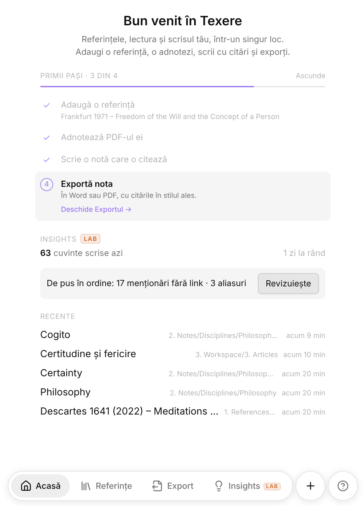

### 1.3 Obsidian în câteva cuvinte

Obsidian lucrează cu fișiere text de pe calculatorul tău, fără cont și fără cloud. Fiecare notă e un fișier `.md`. În stânga ai fișierele și căutarea, la mijloc notele deschise în taburi, iar în dreapta informații despre nota deschisă, de exemplu **Backlinks**, adică notele care trimit la ea. Scrii `[[` ca să legi o notă de alta, iar **Ctrl/Cmd + P** deschide lista tuturor comenzilor. **Ctrl/Cmd + Shift + D** ascunde tot în afară de notele deschise, ca să te poți concentra.

## 2. Referințele și lectura

### 2.1 Adaugi o referință

O referință se adaugă căutând după autor, titlul articolului sau al cărții, ISBN ori DOI, lipind un BibTeX sau din biblioteca ta Zotero. Fiecare referință devine o notă de lectură în **Reading Notes**, iar PDF-ul îl descarcă Texere atunci când îl găsește. Dacă nu îl găsește, îl adaugi tu.

Pentru ca Texere să comunice cu Zotero, activează **Allow other applications on this computer to communicate with Zotero** din setările avansate ale lui Zotero (**Zotero → Preferences/Settings → Advanced**).

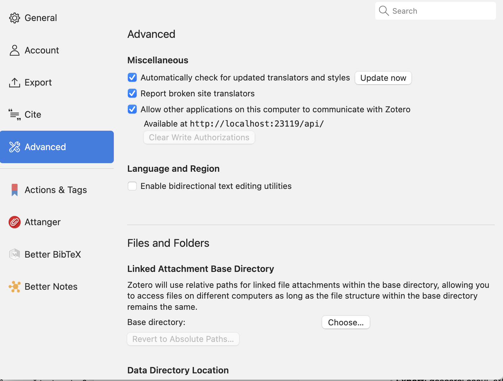

Cum funcționează:
- **Caută**: scrii titlul, autorul, DOI-ul sau ISBN-ul, iar Texere caută în cataloage academice deschise precum OpenAlex, Crossref, Semantic Scholar și Google Books. Pentru fiecare rezultat vezi anul, revista, numărul de citări și dacă PDF-ul e gratuit. Butonul **Adaugă în seif** aduce metadatele (autor, titlu, an, revistă, DOI) împreună cu PDF-ul, dacă există.
- **Zotero**: îți vezi biblioteca din Zotero și bifezi ce vrei să adaugi. **Importă referințele** aduce doar metadatele, iar **Importă referințele și PDF-urile** aduce și PDF-urile, cu evidențierile și adnotările făcute în Zotero, fiecare cu eticheta culorii ei.
- **Alte variante**: poți lipi o citare, un BibTeX sau un DOI, poți completa metadatele de mână, poți salva o referință din browser prin Zotero Connector sau poți face o referință dintr-un PDF pe care îl ai deja, cu **Ctrl/Cmd + P** și **Texere: Adaugă acest PDF ca referință**.

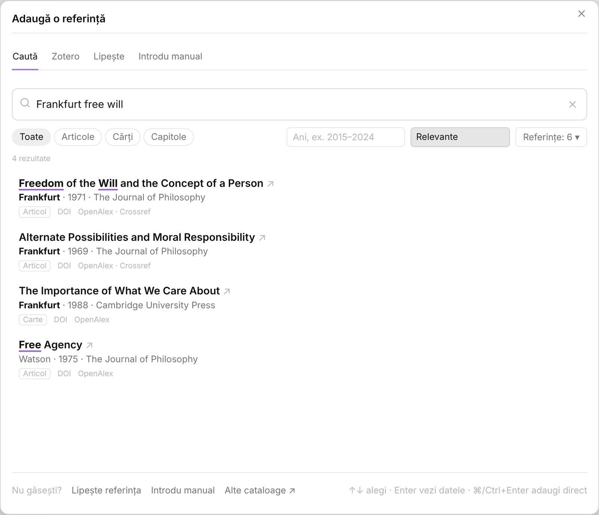

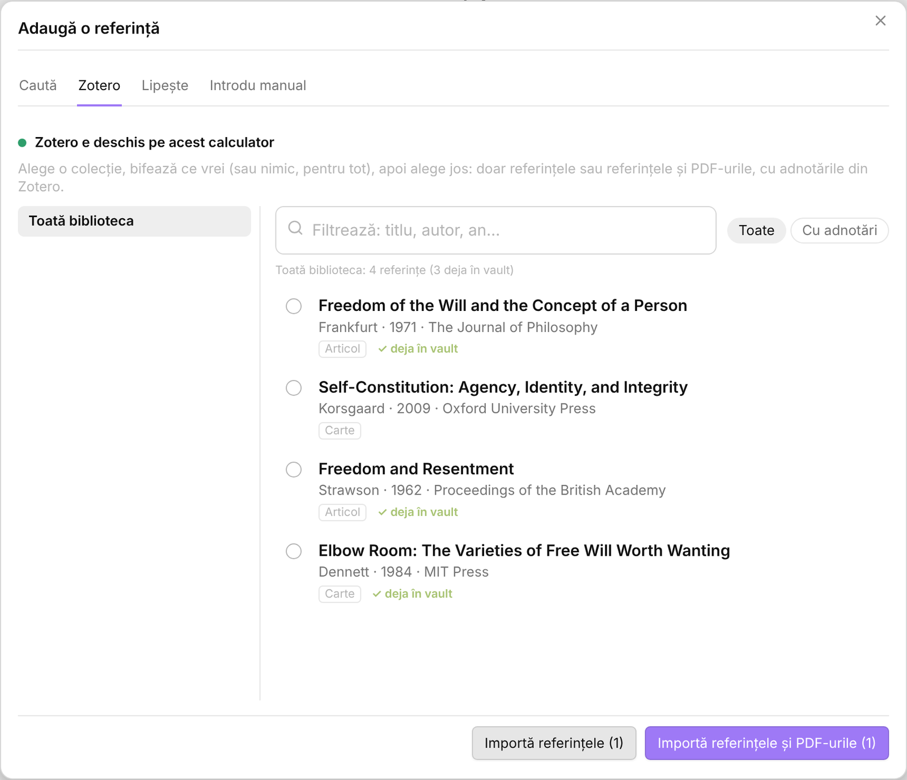

**Avantaje**: referința, PDF-ul și notițele tale stau împreună, în fișiere Markdown, pe calculatorul tău.

O referință din Zotero care e deja în seif primește doar ce îi lipsește, așa că nimic nu se dublează, iar Better BibTeX nu este necesar. Zotero trebuie să fie deschis, dar cu o cheie Zotero, adăugată în **Settings → Texere → Referințe → Zotero**, importul merge și cu Zotero închis. Tot acolo pornești butonul Zotero din browser, prin care un articol salvat cu Zotero Connector ajunge direct în seif. Dacă un catalog îți spune că ai atins limita pe zi, adaugi o cheie gratuită în **Settings → Texere → Referințe → Cataloage**.

### 2.2 Lectura și adnotările

PDF-urile se citesc și se adnotează direct în Obsidian. Fiecare culoare are o etichetă, iar pasajul pe care îl subliniezi ajunge automat în nota de lectură, cu pagina, citarea și un link înapoi la locul exact din PDF.

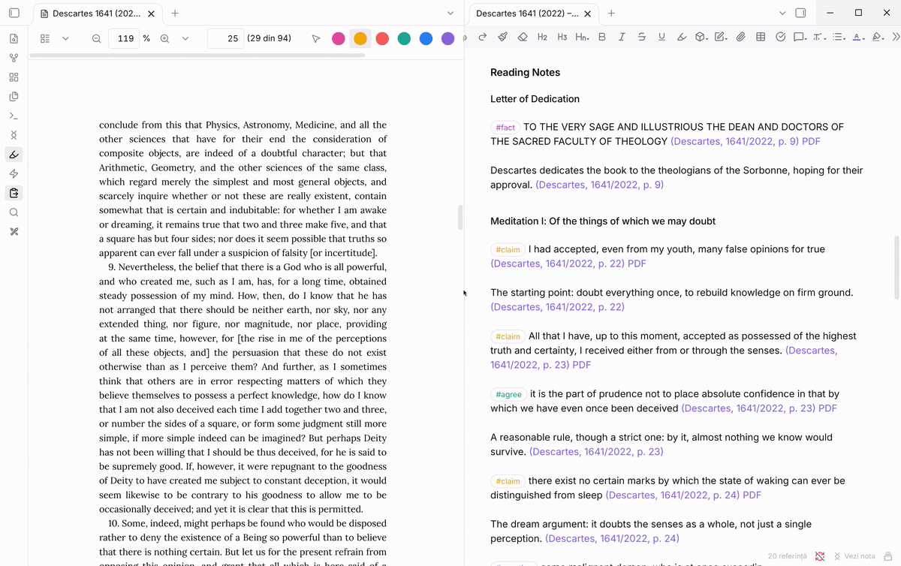

Cum funcționează:
1. Deschizi PDF-ul în paralel cu nota de lectură.
2. Alegi o culoare și selectezi un pasaj.
3. Pasajul este adăugat automat în notă.

| Culoare | Etichetă | Ce marchezi |
| --- | --- | --- |
| roz | `#fact` | fapte, date, cifre |
| galben | `#claim` | afirmațiile autorului |
| roșu | `#disagree` | cu ce nu ești de acord |
| turcoaz | `#agree` | cu ce ești de acord |
| albastru | `#connection` | legături cu alte texte |
| mov | `#question` | întrebări |
| portocaliu | `#definition` | definiții |
| gri | `#word` | termeni de reținut |

**Avantaje**: într-un cititor de PDF obișnuit, sublinierile rămân în fișier. Aici devin notițe pe care le poți căuta în toate lecturile, de exemplu tot ce ai marcat cu `#disagree`. Culoarea pe care o alegi în timp ce citești este deja o primă judecată asupra textului. Sub fiecare pasaj poți scrie una sau două propoziții cu cuvintele tale (**Distilează**, din pagina de pornire), astfel că atunci când începi să scrii, materialul este deja sortat și citat.

Dacă vrei doar să citești, **pointerul** din bara PDF-ului (sau tasta **H**) îți permite să selectezi textul ca să urmărești rândul, fără ca acesta să fie copiat în notă. O evidențiere o ștergi fie din notă, fie din PDF, iar ea dispare din ambele locuri. Adnotările făcute în altă aplicație, cum ar fi Zotero, Preview sau Acrobat, intră și ele în notă, iar pe cele făcute mai târziu le aduci cu clic dreapta pe PDF, **Texere** și **Importă adnotările din PDF**.

## 3. Scrisul

### 3.1 Harta filosofiei

Texere vine cu o hartă a filosofiei, cu câte o notă pentru fiecare ramură, teorie, concept, curent, perioadă și autor, pornind de la nota *Philosophy*. Notele au nume în engleză și în română, așa că dacă scrii `[[Etică` primești *Ethics*.

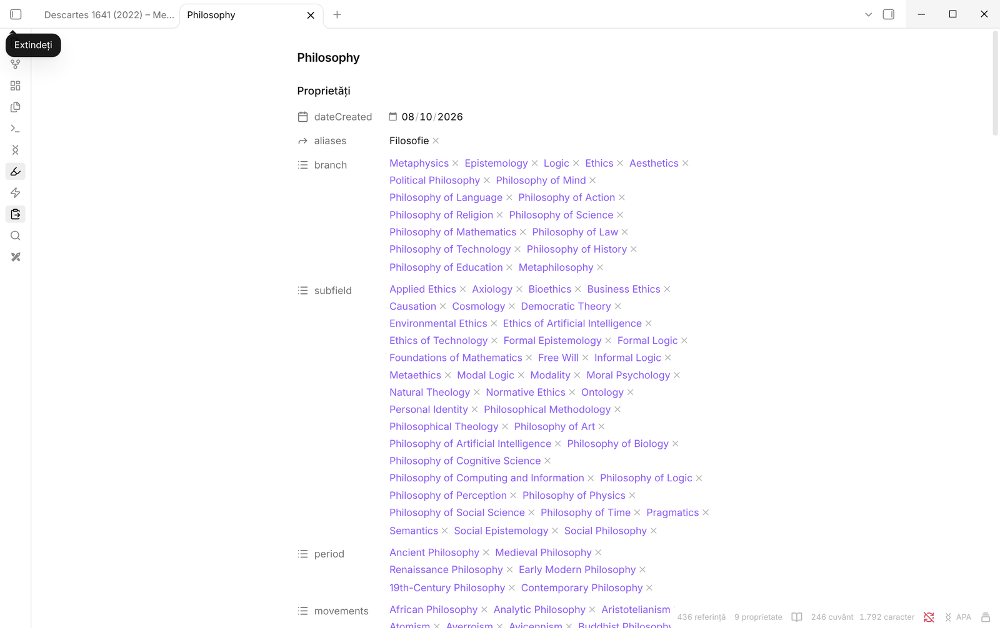

Cum funcționează: fiecare referință și fiecare notă primește câteva proprietăți (*discipline*, *branch*, concepte, autori) care trimit spre notele din hartă. O lectură marcată cu *branch: Epistemology* apare pe pagina Epistemologiei, alături de celelalte lecturi din aceeași ramură.

În graficul Obsidian, pe care îl deschizi cu **Ctrl/Cmd + G**, fiecare punct este o notă, iar liniile sunt legăturile dintre ele. Ramurile, subdomeniile, conceptele, teoriile, curentele, perioadele și autorii au fiecare culoarea lor. Culorile vin odată cu Texere, iar într-un seif mai vechi pagina de pornire ți le propune cu butonul **Adaugă**. Le poți adăuga oricând și cu **Ctrl/Cmd + P** și **Texere: Culori în grafic pentru harta disciplinei**.

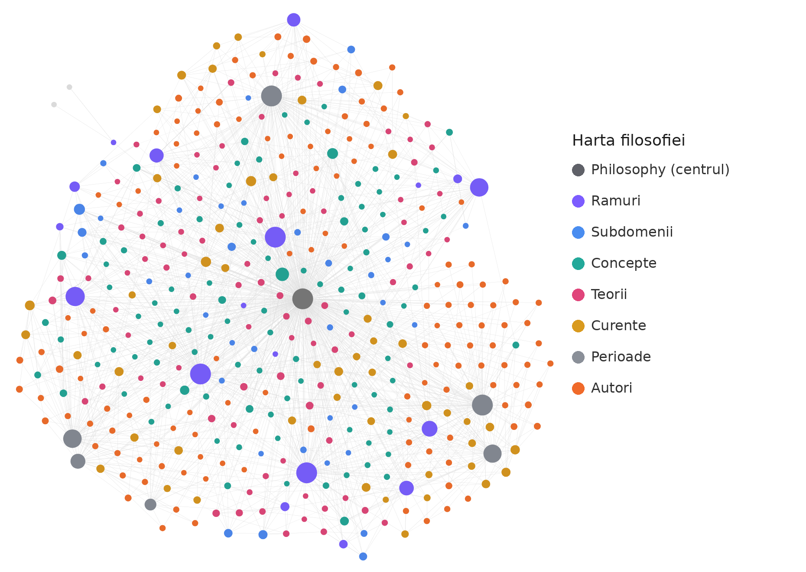

**Avantaje**: lecturile nu mai sunt ordonate doar pe foldere sau pe cursuri, ci și după ramuri și concepte. Când deschizi un concept, vezi tot ce ai citit și ai scris despre el. Harta poate fi adaptată și pentru alte discipline.

### 3.2 Citarea și bibliografia

Citările se adaugă direct în text, din referințele tale sau din Zotero, iar bibliografia se generează singură la finalul notei.

Cum funcționează:
1. Scrii `@` într-o notă, urmat de un cuvânt din numele autorului sau din titlu.
2. Apar referințele tale și, dacă Zotero este deschis, și cele din Zotero, marcate cu eticheta **Zotero**.
3. Alegi referința. Pentru una din Zotero poți alege între **Doar referința**, care aduce doar metadatele, și **Referința și PDF-ul**, care aduce și adnotările din Zotero.
4. Adaugi pagina, de exemplu `[@descartes_meditations_2022, p. 29]`.

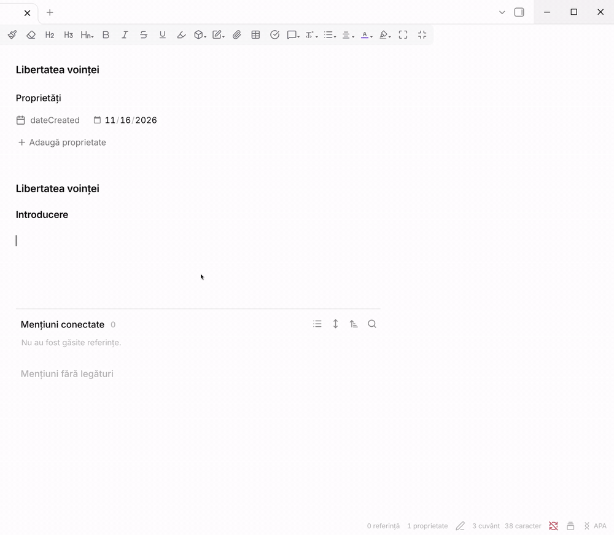

În notă, citarea apare formatată, de pildă *(Descartes, 1641/2022, p. 29)*. Bibliografia se actualizează pe măsură ce scrii, așa că fiecare referință citată apare imediat în ea, iar una pe care nu o mai citezi dispare.

Stilul citărilor se schimbă din bara de jos. Dai clic pe **APA** și alegi alt stil (Chicago, MLA, Harvard, IEEE) sau **Adaugă un stil de citare…**, dintre peste 10.000 disponibile. Citările din text și bibliografia se refac pe loc, iar exportul folosește același stil.

| Scrii | Primești (APA) |
| --- | --- |
| `[@descartes_meditations_2022, p. 29]` | (Descartes, 1641/2022, p. 29) |
| `[@descartes_meditations_2022; @mill_utilitarianism_2022]` | (Descartes, 1641/2022; Mill, 1863/2022) |
| `@descartes_meditations_2022 [p. 29]` | Descartes (1641/2022, p. 29) |

**Avantaje**: funcționează asemănător pluginului Zotero din Word, dar în același loc cu notițele și PDF-urile. Un clic pe o citare te duce la referință sau la pagina din PDF.

### 3.3 Șabloane și ghiduri de scris

Lucrările pornesc ușor dintr-un șablon din **Support/Templates**: **New essay** pentru un eseu sau un articol, **Licență** și **Disertație** pentru lucrările de la Facultatea de Filosofie a Universității din București, după ghidul de redactare al facultății. În **Support/Texere/Guides** găsești ghidurile de scris (**Primii pași în filosofie**, cu varianta în engleză), sursele lor și ghidul de redactare al facultății.

### 3.4 Modul Editare

Când ai o ciornă scrisă, **Modul Editare** te ajută să o lucrezi fără să pierzi nimic. Îl pornești din ✎, sus în notă, și îl închizi cu **Gata**. Selectezi un cuvânt, o propoziție sau un paragraf și încerci **Variante** până alegi una, **Estompezi** un pasaj ca să citești pagina fără el sau îl muți în **Tăieturi**, de unde îl poți aduce înapoi oricând.

## 4. Exportul

Orice notă se poate exporta în PDF, Word sau Markdown, cu citările și bibliografia în stilul ales.

Cum funcționează: apeși **Export** în bara de jos, alegi **PDF**, **Word** sau **Markdown**, verifici previzualizarea și apeși **Exportă**.

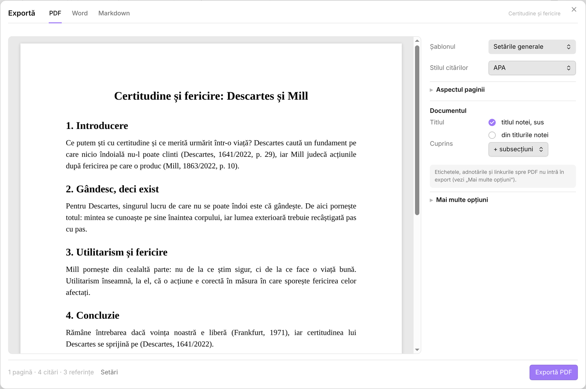

Aspectul paginii vine din șablon, care poate fi unul general sau cel al Facultății de Filosofie, după ghidul de redactare pentru licență și disertație. Cuprinsul și numerele paginilor se adaugă automat, iar fișierul Word poate fi trimis mai departe pentru corecturi, ca orice alt document.

Un șablon al tău îl faci în **Settings → Texere → Export**, iar folderul în care ajung fișierele îl alegi în **Settings → Texere → General → Foldere**. Cuprinsul îl pui unde vrei cu clic dreapta în notă, **Texere** și **Pune cuprinsul aici**.

## 5. Insights (BETA)

Insights citește notele din seif și îți arată cum se leagă ideile tale. Analiza se face local, pe calculatorul tău, prin reguli de programare și fără modele de inteligență artificială.

Pentru cercetare, partea cea mai utilă este **Harta dezbaterii**. Alegi un concept, de exemplu *Happiness*, și vezi pe o singură pagină toate pasajele pe care le-ai subliniat despre el în toate lecturile. Fiecare pasaj are citarea, pagina și notița ta, iar pasajele sunt grupate după autorul sau capitolul din care provin.

Cum funcționează:
1. Deschizi harta din panoul conceptului sau din Insights, la fila **Lectura**, cu butonul **Harta dezbaterii**.
2. Alegi ce te interesează din filtrele de sus, de exemplu **Nu ești de acord** și **Afirmații și definiții**.
3. Apeși **Începe o notă din cele…**, iar Texere creează schița unui text nou cu pasajele alese, grupate pe tipuri, cu citările deja puse și cu un rând pentru răspunsul tău sub fiecare.

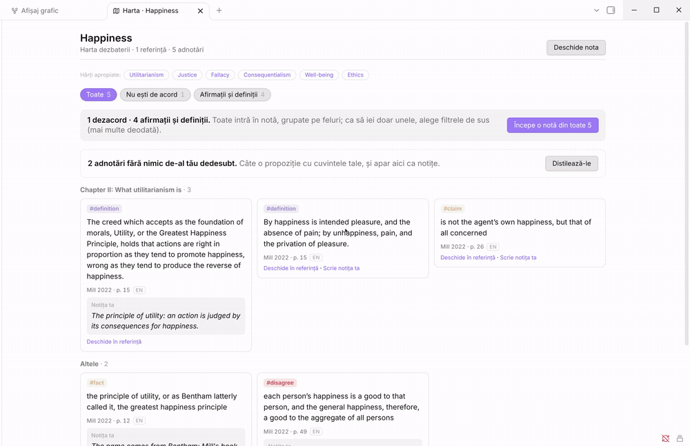

Pe lângă harta dezbaterii, Insights te mai ajută în trei feluri:
- **Linkuri lipsă**: găsește conceptele și autorii pe care i-ai menționat fără link, numele care nu au încă o notă și posibilele dubluri. **Revizuiește** le grupează, iar **Leagă selectate** pune linkurile fără să-ți schimbe textul, astfel încât *„acțiunii”* devine un link spre conceptul *Action*.
- **Panoul conceptului**: în nota unui concept apar definițiile lui din referințele tale, notele în care îl folosești și conceptele alături de care apare în aceleași paragrafe.
- **Tipare**: vezi ce citești, dar nu folosești în scris, subiectele care revin des și conceptele care apar împreună fără să fie legate.

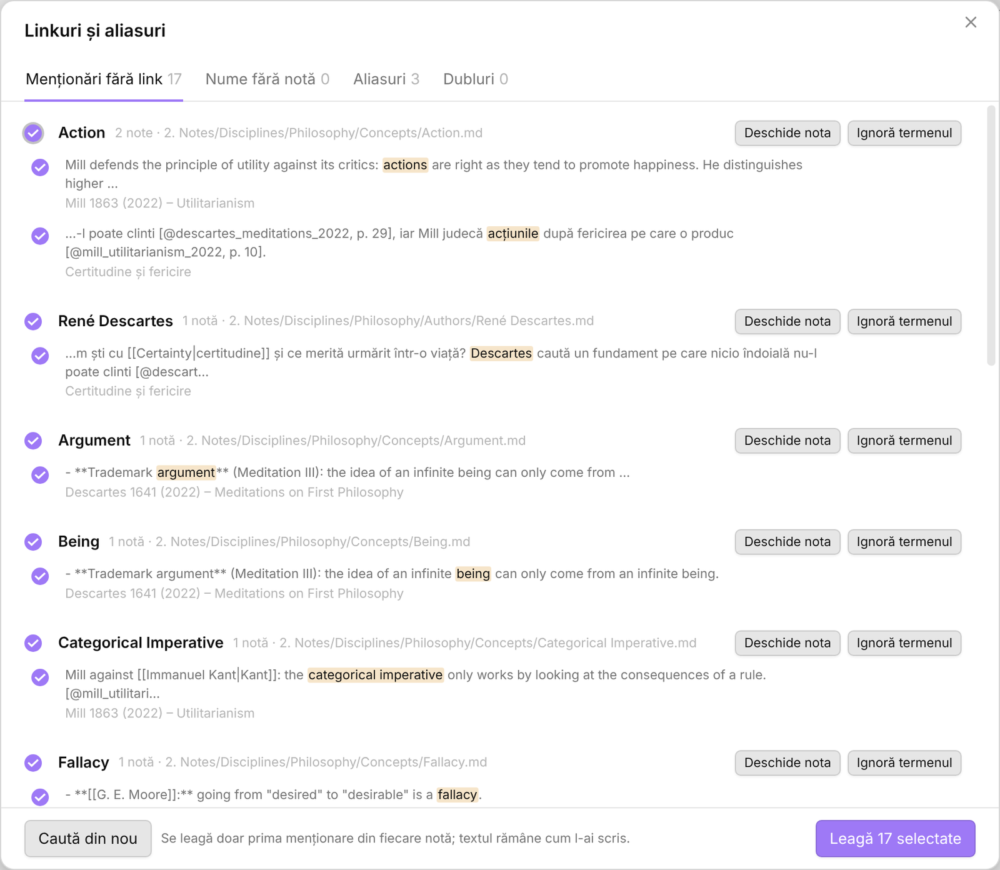

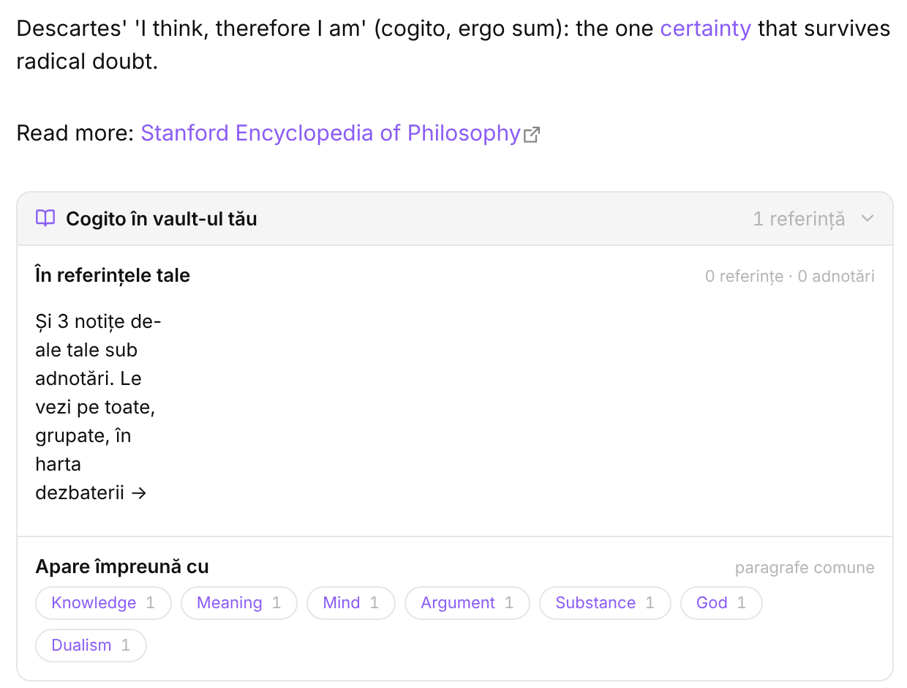

În fila **Scrisul** vezi cât scrii și cum scrii, iar **Verifică ciorna**, din **Însoțitorul scrisului** (clic dreapta pe notă și **Texere**), îți arată ce face fiecare paragraf și ce mai lipsește, după ghidurile de scris din Texere.

**Avantaje**: într-un folder cu documente Word, legătura dintre un text citit acum doi ani și ideea de azi depinde de memorie. În Texere, pasajele subliniate despre același concept se adună singure din toate lecturile, iar un articol nou poate porni direct de la ele.

## 6. Când ceva nu merge

### 6.1 Ce faci întâi

Deschide un tab nou sau **Settings → Texere**. Amândouă îți arată ce lipsește, cu un buton care repară. Dacă tot nu merge, rulează configurarea din nou din **Settings → Texere → General**, iar dacă problema rămâne, scrie-ne din **Settings → Texere → Despre → Semnalează o problemă**. Din când în când, copiază folderul seifului pe un hard disk extern, ca să ai o copie de siguranță.

### 6.2 Probleme frecvente

| Ce vezi | Ce faci |
| --- | --- |
| nu pornește niciun plugin („Restricted mode”) | **Settings → Community plugins → Turn on community plugins** |
| citările rămân `[@citekey]` | pornește modulul **Referințe** din **Settings → Texere → General** |
| la `@` nu apar referințele din Zotero | deschide Zotero și bifează în setările lui, la **Advanced**, **Allow other applications on this computer to communicate with Zotero** |
| un mesaj despre Better BibTeX | vine de la alt plugin, de exemplu Zotero Integration. Texere nu are nevoie de el, iar **Cum rezolv** din mesaj îți arată pașii |
| evidențierea nu intră în notă | pointerul e pornit: apasă **H** sau alege o culoare |
| lipsesc adnotări în notă | clic dreapta pe PDF, **Texere** și **Importă adnotările din PDF** |
| „limită atinsă” la căutare | adaugă o cheie gratuită în **Settings → Texere → Referințe → Cataloage** |
| nu găsești fișierul exportat | verifică folderul exportului în **Settings → Texere → General → Foldere** |

### 6.3 Configurarea manuală

Dacă configurarea nu a putut face un pas, îl faci tu, de mână:

1. **Pluginurile**: în **Settings → Community plugins** apeși **Turn on community plugins**.
2. **Modulele**: în **Settings → Texere → General → Modulele** pornești Referințe și Export.
3. **PDF++**: în **Settings → Texere → General → Avansat** apeși **Deschide pagina lui**, apoi **Install** și **Enable**, sau **Pornește**, dacă e deja instalat.
4. **Bibliografia**: în **Settings → Texere → Referințe → Note și citări**, **Eticheta notei** trebuie să fie `literature_note`, apoi apeși **Avansat → Bibliografia → Refă din note**.
5. **Folderul exportului**: îl alegi în **Settings → Texere → General → Foldere → Folderul exportului**.
6. **Șabloanele și ghidurile**: **Settings → Texere → General → Avansat → Șabloanele și ghidurile de scris** le adaugă pe cele care lipsesc, fără să le atingă pe ale tale.

## 7. Ce e nou

Texere caută singur versiunile noi. Când apare una, pagina de pornire ți-o arată, iar tu o instalezi cu **Actualizează** și **Reîncarcă**. Ce aduce o versiune pentru seif, de exemplu un șablon nou, doar ți se propune, cu **Adaugă** sau **Nu acum**. Toate versiunile sunt pe [pagina Texere](https://github.com/gorgmihai92/texere-plugin/blob/main/CHANGELOG.md).

**0.5.2** · 16 noiembrie 2026
- **Seif în loc de vault:** în română, Texere spune acum peste tot „seif”.

**0.5.1** · 16 noiembrie 2026
- **Un Ajutor mai scurt:** ghidul și întrebările frecvente urmează tutorialul de început, pe scurt și cu imagini.

**0.5.0** · 16 noiembrie 2026
- **Un singur drum, doar pluginul:** Texere se instalează prin BRAT în orice seif, gol sau cu notele tale, pe Windows și pe Mac. Configurarea aduce tot, inclusiv ghidul de redactare al facultății și sursele ghidurilor de scris, iar harta filosofiei vine colorată în grafic.

**0.4.24** · 16 noiembrie 2026
- **Harta filosofiei, colorată în grafic**, și **comentariile adnotărilor din Zotero**, care ajung acum în nota de lectură.
